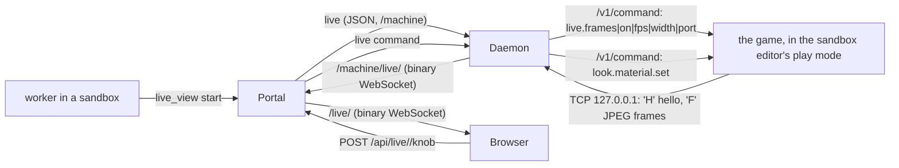

# Live view (w1398)

**What it is.** A person chats with an asset agent and watches the asset change in the running game beside the chat,
on desktop and on a phone. The shader's own properties appear as knobs the person can drag. Ben's words (w1393): "the
game should just show a preview of that asset rendering in the engine, so the right lighting and everything. And then
I can say, like, oh, change how much this glows". The plan and its measurements are in the w1393 review folder
(`w1393-live-asset-plan.md`).

**Off by default.** It is on only when the portal's config has `"live": { "enabled": true }`. An owner's orchestrator
turns it on with `set_app_config` key `live.enabled`, value `true` (w1417; an owner's only, applied at once, no
restart). `false` or `null` turns it off and stops every running view. With the switch off, the `live_view` tool
refuses, the routes answer 404, and the page shows nothing new. Machines offer a live view only once their daemon has
the w1398 code (a verified deploy updates them).

## How it fits together

- **The game half** is the game repo's `LiveLook`
  (`Assets/Scripts/Behaviours/Multiplayer/AgentControl/LiveLook.cs`, FinalFactory #1822). It provides four dev-tier
  `ffauto:` commands through the game's agent channel: `live.frames`, `look.material.list|set|reset`.
  - A knob changes the loaded material on this machine only.
  - It is never saved: the original comes back on reset, on leaving play mode, on a script reload, and on quit.
- **The machine half** is `machine/live.ts`, and the daemon runs one `LiveSession` per view. It reads the game's
  `AgentControl/session-<pid>.json`, using the pid of the sandbox editor.
  - It gives the play session's channel the dev tier once, through the editor's MCP bridge (`DEV_TIER_SNIPPET`).
  - It asks the game to stream to a loopback port, answers every frame at once, and keeps only the newest one.
  - Whenever the stream drops, it reports `holding` with the reason and tries again every 3 s. A stream drops when
    the editor leaves play mode, reloads scripts, or starts a new session on a new port.
- **The portal half** is `server/live.ts`. It holds the views, takes each daemon's frame socket and passes the newest
  frame to each watching page. A page that is behind gets the next frame, never a queue.
  - Compression is off: JPEG does not compress.

## The agent's tool: `live_view`

`live_view` is a worker tool, in the sandboxes group.

| Field | What it does |
|---|---|
| `action: "start"` | Starts a view of its sandbox's game. Optional: `materials` (names the game knows, e.g. `["VfxComet"]`), `fps` (default 15, at most 30) and `width` (default 960, 320 to 1920). |
| `action: "stop"` | Stops the view. |
| `action: "status"` | Answers the view's state. |
| `action: "knobs"` | Reads the current knob values, the same JSON the page reads. |

- The editor must be in play mode with the asset on screen. Staging it is the agent's job, as for any capture.

## The page

- **Where it lives:** `#/live/<sessionId>`. A wide screen shows the view and its knobs beside the session's
  conversation. A phone shows the view on top, then the controls, then the conversation, with the knobs in a bottom
  sheet.
- **How you get there:** the session's header shows "Live view" while a view is running. Since w1430 the sidebar shows
  "Live view: go" on the slot's row when its worker waits on you, or is between turns with its view up and you asked for
  it ([machines.md](machines.md), "In the web UI"), and the request's card on the Dispatcher's "Waiting on input" tab has
  the same button.

| Route | What it does |
|---|---|
| `WS /live/<sessionId>` | Binary messages, each one JPEG frame. The page draws the newest one. |
| `GET /api/live/<sessionId>/knobs` | Answers `LiveMaterialKnobs[]`, one entry per material. |
| `POST /api/live/<sessionId>/knob` | Takes `LiveKnobRequest` (`{ material, name, value }`) and answers `{ ok, knob }`. |
| `POST /api/live/<sessionId>/reset` | Takes `{ material? }` and puts the knobs back. |

- `AppState.live` lists the views this person may watch. `{ type: 'live', views }` events keep the list current.
- `AppState.config.live.enabled` says whether the switch is on.

**Who may watch and turn the knobs:** the session's requester (`requestedBy`, or `lastRequestedBy`) and the owners.

**What a knob move does:**
1. It writes a system line into the agent's conversation, through the daemon that owns the session (its own seqs).
2. The agent's next message from a person starts with the knob values set since then, so the agent knows them.
3. It counts as activity in that sandbox, so the editor does not idle-stop while someone is tuning.
4. The knob value itself is not kept. Keeping a value is the agent's edit of the `.mat`, committed like any other
   change.

## Measured, w1393 and w1398 (beast)

- **Edit to frame:** a material property edit shows in the next rendered frame (17.5 ms). A knob sent through the
  stream showed in the next streamed frame.
- **Agent channel:** `/v1/command` takes a median 12.3 ms in editor play mode.
- **Stream rate:** 30 fps asked at 960 px gave 23.2 fps received, with a 64 KB median JPEG (about 11.6 Mbit/s).
- **Editor fps:** 52 unfocused and 42 covered, but 12.6 minimized, so never minimize the live editor.
- **The link:**
  - Portal to beast over the tailnet carries 18–48 Mbit/s sustained.
  - Ben's MacBook reaches the tailnet through a relay (DERP) at 128 ms; its throughput is not measured.
