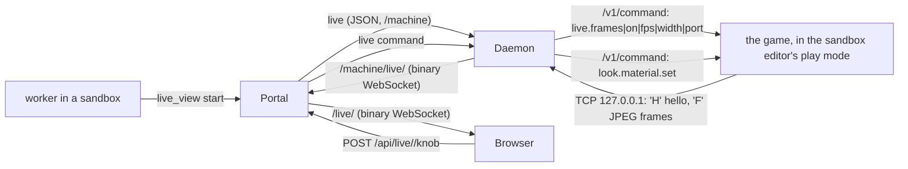

# Live view (w1398)

**What it is.** A person chats with an asset agent and watches the asset change in the running game beside the chat,
on desktop and on a phone. The shader's own properties appear as knobs the person can drag. Ben's words (w1393): "the
game should just show a preview of that asset rendering in the engine, so the right lighting and everything. And then
I can say, like, oh, change how much this glows". The plan and its measurements are in the w1393 review folder
(`w1393-live-asset-plan.md`).

**Off by default.** It is on only when the portal's config has `"live": { "enabled": true }`. An owner's orchestrator
turns it on with `set_app_config` key `live.enabled`, value `true` (w1417; an owner's only, applied at once, no
restart). `false` or `null` turns it off and stops every running view. With the switch off, the `live_view` tool
refuses, the routes answer 404, and the page shows nothing new. Machines offer a live view only once their daemon has
the w1398 code (a verified deploy updates them).

## How it fits together

- **The game half** is the game repo's `LiveLook`
  (`Assets/Scripts/Behaviours/Multiplayer/AgentControl/LiveLook.cs`, FinalFactory #1822). It provides four dev-tier
  `ffauto:` commands through the game's agent channel: `live.frames`, `look.material.list|set|reset`.
  - A knob changes the loaded material on this machine only.
  - It is never saved: the original comes back on reset, on leaving play mode, on a script reload, and on quit.
- **The machine half** is `machine/live.ts`, and the daemon runs one `LiveSession` per view. It reads the game's
  `AgentControl/session-<pid>.json`, using the pid of the sandbox editor.
  - It gives the play session's channel the dev tier once, through the editor's MCP bridge (`DEV_TIER_SNIPPET`).
  - It asks the game to stream to a loopback port, answers every frame at once, and keeps only the newest one.
  - Whenever the stream drops, it reports `holding` with the reason and tries again every 3 s. A stream drops when
    the editor leaves play mode, reloads scripts, or starts a new session on a new port.
- **The portal half** is `server/live.ts`. It holds the views, takes each daemon's frame socket and passes the newest
  frame to each watching page. A page that is behind gets the next frame, never a queue.
  - Compression is off: JPEG does not compress.

## Flow control (w1601)

Ben, 2026-10-19: "live view is often too slow". Each hop that can fall behind keeps only what its link carries in one
round trip, so the view lags the game by about a round trip and a frame on any link, instead of by the seconds of
frames that pile up in socket buffers on a link slower than the stream.

- **The far end answers.** The portal answers each frame from the daemon, and the page answers each frame it has drawn,
  with a text message `a<count>`: how many frames that socket has brought so far.
- **The pump keeps a window.** `FramePump` (`shared/framePump.ts`) runs on the daemon's link to the portal and on each
  page the portal feeds.
  - It sends only while the bytes unanswered fit a window: the fastest delivery rate measured from the answers times
    the shortest round trip, plus one frame. That is BBR's way of sizing a window.
  - A frame that does not fit waits, and a newer one replaces it.
  - One frame may always go when nothing is in flight.
- **Old ends still work.** A far end that never answers (a daemon or page from before w1601) keeps the old rule: send
  while the socket buffers under 256 KB (daemon) or 1 MB (page).
- **What a page gets.** `live_view status` ends with each watching page's frames drawn, frames skipped, round trip and
  the rate its link carried, so an agent can see how the view reaches Ben.
- **The game half (FinalFactory, w1601).** `LiveFrameStream` reads back the next frame while the last one encodes and
  sends, and a newer frame replaces one not yet sent. Before, each frame waited for its own readback, encode and the
  daemon's answer before the next readback started, so the stream ran at a fraction of the game's rate. It takes
  frames on a schedule, so a 20 fps game streams 15 by taking three frames in four (a gap of 1/fps took every other
  one). `live.frames` (status) prints each stage's mean and worst time and the game's own fps (`game_fps`).

## The agent's tool: `live_view`

`live_view` is a worker tool, in the sandboxes group.

| Field | What it does |
|---|---|
| `action: "start"` | Starts a view of its sandbox's game. Optional: `materials` (names the game knows, e.g. `["VfxComet"]`), `fps` (default 15, at most 30) and `width` (default 960, 320 to 1920). |
| `action: "stop"` | Stops the view. |
| `action: "status"` | Answers the view's state. |
| `action: "knobs"` | Reads the current knob values, the same JSON the page reads. |

- The editor must be in play mode with the asset on screen. Staging it is the agent's job, as for any capture.

## The page

- **Where it lives:** `#/live/<sessionId>`. A wide screen shows the view and its knobs beside the session's
  conversation. A phone shows the view on top, then the controls, then the conversation, with the knobs in a bottom
  sheet.
- **How you get there:** the session's header shows "Live view" while a view is running. Since w1430 the sidebar shows
  "Live view: go" on the slot's row when its worker waits on you, or is between turns with its view up and you asked for
  it ([machines.md](machines.md), "In the web UI"), and the request's card on the Dispatcher's "Waiting on input" tab has
  the same button. Since w1599 every person who may watch a running view (the requester and the owners, below) sees the
  button on the slot's row whenever the view is up, quiet and outlined when it is not waiting on them; the amber one stays
  for the person it waits on. Anyone else sees none.

| Route | What it does |
|---|---|
| `WS /live/<sessionId>` | Binary messages, each one JPEG frame. The page draws the newest one. |
| `GET /api/live/<sessionId>/knobs` | Answers `LiveMaterialKnobs[]`, one entry per material. |
| `POST /api/live/<sessionId>/knob` | Takes `LiveKnobRequest` (`{ material, name, value }`) and answers `{ ok, knob }`. |
| `POST /api/live/<sessionId>/reset` | Takes `{ material? }` and puts the knobs back. |

- `AppState.live` lists the views this person may watch. `{ type: 'live', views }` events keep the list current.
- `AppState.config.live.enabled` says whether the switch is on.

**Who may watch and turn the knobs:** the session's requester (`requestedBy`, or `lastRequestedBy`) and the owners.

**What a knob move does:**
1. It writes a system line into the agent's conversation, through the daemon that owns the session (its own seqs).
2. The agent's next message from a person starts with the knob values set since then, so the agent knows them.
3. It counts as activity in that sandbox, so the editor does not idle-stop while someone is tuning.
4. The knob value itself is not kept. Keeping a value is the agent's edit of the `.mat`, committed like any other
   change.

**Knobs the game sets itself (w1509).** When the game can see that something else sets a property, it says why in the
knob's `driven` field, and the page folds that knob away under "N more the game sets itself", with the reason in
place of a control. The game sees three kinds:
- a value written back after the knob set it;
- a MaterialPropertyBlock on a Renderer;
- Entities Graphics reading the property per entity.

The game's `LiveLook.WhyNotLive` and `Documentation/Live-View-Knobs.md` describe them. The panel reads the knobs again
1.5 s after the last answer, so it catches a written-back value.

The game cannot see a MaterialPropertyBlock that a system passes to `Graphics.RenderMesh`. The station shield's charge
and clock are set that way. Its shader marks such properties `[PerRendererData]`, which keeps them off the knobs.

**Restarts (w1509).** A daemon restarts on every machine rollout, and its views end with it. Its hello lists the views
it runs (`liveViews`), and the portal acts on the hello:
- **A view of that machine the daemon no longer runs:** the portal starts it again with the same id, materials and
  settings, so the page's frames and knobs come back by themselves.
- **A view this portal no longer knows (the portal restarted):** the portal takes it back while its session is still
  on that sandbox, and stops it otherwise.

Before this, the page kept showing the view as live with the last frame. Every knob was then refused with "this live
view is not running on the machine".

## While it waits on you (w1582)

Ben steers the art in the view by talking to the agent, often hours after its turn ended. Ben, 2026-10-19: "The live
views aren't working". Four art workers (w1465, w1466, w1468, w1475) had each ended a turn waiting on him with a view
up, and the w890 release (machines.md, "Placing work") stopped each about 6 minutes later and released its sandbox 4
minutes after that. The portal journal shows it for w1465's c522aec6 on 2026-10-19: wait declared 19:29Z, stopped
19:35Z, released 19:39Z, and the same at 20:00Z/20:01Z and 20:38Z/20:39Z after each check-in. His words then went to
a stopped agent, which had to start again (on lothdesktop it could not: the disk floor), and the sandbox's editor went
to other work or stopped idle two hours later, so the view held its last frame or showed the next worker's game.

Now:
- **Held.** A worker whose view runs while it waits on a person (its `waiting_on_person`, or a request of it Waiting
  on input) is neither stopped nor released for `LIVE_HOLD_MS` (12 hours) after its last activity:
  `Agents.liveHold`, `releaseStep` in `server/placeAgain.ts`, and the idle reaper's `keepIdle`. list_sandboxes says
  "its Live view is up while it waits on Ben". A wait on a deploy, a request or CI is no hold: nobody is about to look.
- **The editor stays up.** The daemon counts a running view as activity in its sandbox (`sandboxActivity`,
  `machine/daemon.ts`), so the 120-minute idle stop leaves its editor alone while the view runs.
- **Ended, then staged again.** When the hold is over, or the sandbox is released any other way, the release pass stops
  the view (`PlaceAgainDeps.liveLost`, `LiveHub.endFor`), so it never shows another worker's game, and records it on the
  session (`SessionInfo.liveLost`). The worker's next message, a person's or its check-in, starts with a `[live view]`
  line (`liveLostNote`): start the editor, stage the scene, and `live_view start` with the same materials, fps and width
  before answering. A stopped worker whose sandbox stays its (unsaved work) past the hold has its view ended the same
  way, so its editor can idle-stop.

## On BEAST first (w1600)

A build declared coming on BEAST (w1606, docs/orchestrators.md "Builds clear BEAST") leaves a worker whose Live view
runs alone: a view a person may be steering comes before a build, and the build runs beside it.

Ben, 2026-10-19: "can you prioritize beast for stuff that needs live view? live view is often too slow". The view's frame
rate is the sandbox editor's, so the machine matters:

- **Placed there.** A request needs a Live view once its worker runs `live_view start` (`WorkItem.liveView`) or its words
  ask for one, and it goes where the Capacity block's "Next Live view work" says: `placement.live`, BEAST unless set, else
  the general placement ([machines.md](machines.md), "Placing work").
- **Moved there.** A worker that waits on a person with its view up elsewhere is moved by the dispatcher with `stop_agent`
  `move_to: "beast"`: its view ends, and its request goes to a new session on BEAST, whose handover carries the view's
  materials, fps and width to stage again. A conversation does not move between computers.
- **Never beside a timed run.** While BEAST's bench lock is held (`machine/benchLock.ts`), a worker on Live view work there
  is refused its editor start and `live_view start` and waits for the lock.
- **The numbers so far.** BEAST: 23.2 fps received at 30 asked, 960 px (w1398, below). lothdesktop: about 3 fps for the
  w1466 view (the w1600 request), then 15 fps stream (its asked rate) at about 30 fps in game on 2026-10-20 03:36Z (its
  worker's own report). The default 15 fps hides the difference on a light scene; heavy scenes and 30 fps show it.
  BEAST, the w1475 Shield Battery view on the raid save (beast/slot3, 2026-10-22, its worker's measurement): the game at
  34.4 fps in play mode (2588 frames in 75.2 s), and 30 fps asked at 1280 px. The stream delivered about 16 frames a
  second while Ben watched, and about 9.8 with nobody watching. The game ran faster than the stream, so the stream, not
  the machine, set the rate the person saw (a guess: the worker thought the stream sends fewer frames with nobody
  watching). Nobody measured that view on the m5, where it ran before, so there is no same-view before and after.

## Measured, w1393 and w1398 (beast)

- **Edit to frame:** a material property edit shows in the next rendered frame (17.5 ms). A knob sent through the
  stream showed in the next streamed frame.
- **Agent channel:** `/v1/command` takes a median 12.3 ms in editor play mode.
- **Stream rate:** 30 fps asked at 960 px gave 23.2 fps received, with a 64 KB median JPEG (about 11.6 Mbit/s).
- **Editor fps:** 52 unfocused and 42 covered, but 12.6 minimized, so never minimize the live editor.
- **The link:**
  - Portal to beast over the tailnet carries 18–48 Mbit/s sustained.
  - Ben's MacBook reaches the tailnet through a relay (DERP) at 128 ms; its throughput is not measured.

## Measured, w1601 (beast)

`scripts/liveLatencyBench.ts` runs the real daemon half (`LiveSession`) against the sandbox editor in play mode (a new
game), the real portal half (`LiveHub`, from `--repo`, so an older checkout is the "before"), and a headless page that
draws frames the way `LiveStage` does. The links are emulated: link A (daemon to portal) 40 Mbit/s with 20 ms (a guess),
link B (portal to page) at the speed in the table with Ben's 128 ms round trip. Every 3 s it hides or shows the game's
HUD (`ui.hide`) and times the first drawn frame that shows it. Each leg ran 40 s; 2026-10-19, under the bench lock.

Check the game's own frame rate before you time the stream (`game_fps` in `live.frames`). The game starts capped at
20 fps (`DisplaySettingsController.Awake`, game repo `Assets/Scripts/Behaviours/Settings/DisplaySettingsController.cs:48`)
and lifts the cap only when it loads into a game (`StartController.cs:300`, `SaveGameManager.cs:1497`). A new game
started by script before the title screen has finished loading stayed at 20 fps on beast, and later hung on
"loading". Wait for the title screen (`Ecs.Ready` and the ItemConfig singleton) before you start the game, or call
`ResetTemporaryFpsCap()`. The "game held at 20 fps" legs below keep that cap on purpose.

| Leg | Game → daemon fps, before → after | HUD change to drawn frame p50/p95 ms, before → after |
|---|---|---|
| 15 fps, 960 px, 100 Mbit/s | 12.9 → 15.0 | 219/250 → 235/252 |
| 30 fps, 960 px, 100 Mbit/s | 17.8 → 29.3 | 220/254 → 216/240 |
| 15 fps, 960 px, game held at 20 fps | 9.7 → 15.0 | 295/460 → 291/310 |
| 30 fps, 960 px, game held at 20 fps | 10.0 → 19.8 | 292/318 → 291/314 |
| 20 fps, 1280 px, 10 Mbit/s (12.5 fps drawn either way) | 17.1 → 20.0 | 2150/2277 → 409/438 |
| 15 fps, 960 px, 5 Mbit/s (9 fps drawn either way) | 13.0 → 15.0 | 825/1092 → 499/559 |
| 15 fps, 960 px, 100 Mbit/s, WebKit | 12.7 → 14.4 | 224/260 → 238/256 |

- **Where the time goes on a fast link** (the after status, game at 45–58 fps): the GPU readback 41–47 ms mean (two
  game frames; 78 ms at 20 fps), the JPEG encode 4 ms at 960 px and 7 ms at 1280, the write and the daemon's answer
  0.3 ms, decode in the page 2–4 ms, the game's command channel 23–33 ms. The rest is the link: 64 ms one way to Ben.
- **On a link slower than the stream** the drawn rate is what the link carries (frame size times fps); since w1601 that
  costs frames, not seconds. A smaller frame (width, quality, or a video codec) is what would raise the rate there.
- **The game's own rate bounds the stream.** A Live view of a late-game save runs at the game's rate: the w1466 worker
  measured 0.5 fps on lothdesktop with the stream stopped (LogisticsNetworkConsumerUnitFinderJob, w1604).
