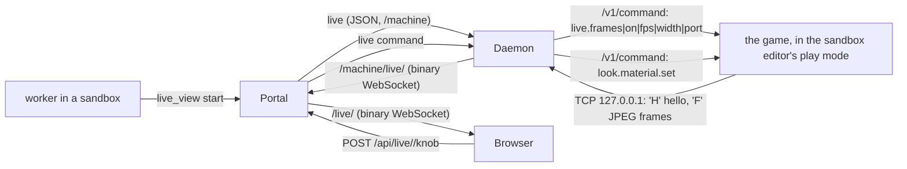

# Live view (w1398)

**What it is.** A person chats with an asset agent and watches the asset change in the running game beside the chat,
on desktop and on a phone. The shader's own properties appear as knobs the person can drag. Ben's words (w1393): "the
game should just show a preview of that asset rendering in the engine, so the right lighting and everything. And then
I can say, like, oh, change how much this glows". The plan and its measurements are in the w1393 review folder
(`w1393-live-asset-plan.md`).

**Off by default.** It is on only when the portal's config has `"live": { "enabled": true }`. An owner's orchestrator
turns it on with `set_app_config` key `live.enabled`, value `true` (w1417; an owner's only, applied at once, no
restart). `false` or `null` turns it off and stops every running view. With the switch off, the `live_view` tool
refuses, the routes answer 404, and the page shows nothing new. Machines offer a live view only once their daemon has
the w1398 code (a verified deploy updates them).

## How it fits together

- **The game half** is the game repo's `LiveLook`
  (`Assets/Scripts/Behaviours/Multiplayer/AgentControl/LiveLook.cs`, FinalFactory #1822). It provides four dev-tier
  `ffauto:` commands through the game's agent channel: `live.frames`, `look.material.list|set|reset`.
  - A knob changes the loaded material on this machine only.
  - It is not saved: the original comes back on reset, on leaving play mode, on a script reload, and on quit, unless the person keeps it (Keep, w1839, below).
- **The machine half** is `machine/live.ts`, and the daemon runs one `LiveSession` per view. It reads the game's
  `AgentControl/session-<pid>.json`, using the pid of the sandbox editor.
  - It gives the play session's channel the dev tier once, through the editor's MCP bridge (`DEV_TIER_SNIPPET`).
  - It asks the game to stream to a loopback port, answers every frame at once, and keeps only the newest one.
  - Whenever the stream drops, it reports `holding` with the reason and looks again every second (3 s before w1838; a
    try that asked the editor for something and failed waits 3 s). A stream drops when the editor leaves play mode,
    reloads scripts, or starts a new session on a new port.
- **The portal half** is `server/live.ts`. It holds the views, takes each daemon's frame socket and passes the newest
  frame to each watching page. A page that is behind gets the next frame, never a queue.
  - Compression is off: JPEG does not compress.

## Flow control (w1601)

Ben, 2026-10-19: "live view is often too slow". Each hop that can fall behind keeps only what its link carries in one
round trip, so the view lags the game by about a round trip and a frame on any link, instead of by the seconds of
frames that pile up in socket buffers on a link slower than the stream.

- **The far end answers.** The portal answers each frame from the daemon, and the page answers each frame it has drawn,
  with a text message `a<count>`: how many frames that socket has brought so far.
- **The pump keeps a window.** `FramePump` (`shared/framePump.ts`) runs on the daemon's link to the portal and on each
  page the portal feeds.
  - It sends only while the bytes unanswered fit a window: the fastest delivery rate measured from the answers times
    the shortest round trip, plus one frame. That is BBR's way of sizing a window.
  - A frame that does not fit waits, and a newer one replaces it.
  - One frame may always go when nothing is in flight.
- **Old ends still work.** A far end that never answers (a daemon or page from before w1601) keeps the old rule: send
  while the socket buffers under 256 KB (daemon) or 1 MB (page).
- **What a page gets.** `live_view status` ends with each watching page's frames drawn, frames skipped, round trip and
  the rate its link carried, so an agent can see how the view reaches Ben.
- **The game half (FinalFactory, w1601).** `LiveFrameStream` reads back the next frame while the last one encodes and
  sends, and a newer frame replaces one not yet sent. Before, each frame waited for its own readback, encode and the
  daemon's answer before the next readback started, so the stream ran at a fraction of the game's rate. It takes
  frames on a schedule, so a 20 fps game streams 15 by taking three frames in four (a gap of 1/fps took every other
  one). `live.frames` (status) prints each stage's mean and worst time and the game's own fps (`game_fps`).

## The agent's tool: `live_view`

`live_view` is a worker tool, in the sandboxes group.

| Field | What it does |
|---|---|
| `action: "start"` | Starts a view of its sandbox's game. Optional: `materials` (names the game knows, e.g. `["VfxComet"]`), `fps` (default 15, at most 30), `width` (default 960, 320 to 1920) and `stage` (a recipe, below). |
| `action: "stop"` | Stops the view. |
| `action: "status"` | Answers the view's state. |
| `action: "knobs"` | Reads the current knob values, the same JSON the page reads. |
| `action: "stage"` | Sets (or replaces) the view's stage recipe: `stage`, a list of steps ("Staged again without a turn" below). An empty list clears it. |
| `action: "restage"` | Tests the recipe: the daemon sets the view up again now. `status` then shows how it went and how long each leg took. |

- The editor must be in play mode with the asset on screen. Staging it is the agent's job, as for any capture.

## The page

- **Where it lives:** `#/live/<sessionId>`. A wide screen shows the view and its knobs beside the session's
  conversation. A phone shows the view on top, then the controls, then the conversation, with the knobs in a bottom
  sheet.
- **How you get there:** the session's header shows "Live view" while a view is running. Since w1430 the sidebar shows
  "Live view: go" on the slot's row when its worker waits on you, or is between turns with its view up and you asked for
  it ([machines.md](machines.md), "In the web UI"), and the request's card on the Dispatcher's "Waiting on input" tab has
  the same button. Since w1599 every person who may watch a running view (the requester and the owners, below) sees the
  button on the slot's row whenever the view is up, quiet and outlined when it is not waiting on them; the amber one stays
  for the person it waits on. Anyone else sees none. Since w1838 the button says "go" only while the view can be used, and
  otherwise what it waits on ("Ready or not" below).

| Route | What it does |
|---|---|
| `WS /live/<sessionId>` | Binary messages, each one JPEG frame. The page draws the newest one. |
| `GET /api/live/<sessionId>/knobs` | Answers `LiveMaterialKnobs[]`, one entry per material. |
| `POST /api/live/<sessionId>/knob` | Takes `LiveKnobRequest` (`{ material, name, value }`) and answers `{ ok, knob }`. |
| `POST /api/live/<sessionId>/reset` | Takes `{ material? }` and puts the knobs back. |
| `POST /api/live/<sessionId>/keep` | Takes `{ material }` and writes its moved knobs into the material's `.mat` on the worker's branch ("Keep (w1839)" below). Answers `{ ok, kept: [{ name, path, change }] }`. |

- `AppState.live` lists the views this person may watch. `{ type: 'live', views }` events keep the list current.
- `AppState.config.live.enabled` says whether the switch is on.

**Who may watch and turn the knobs:** the session's requester (`requestedBy`, or `lastRequestedBy`) and the owners.

**What a knob move does:**
1. It writes a system line into the agent's conversation, through the daemon that owns the session (its own seqs).
2. The agent's next message from a person starts with the knob values set since then, so the agent knows them.
3. It counts as activity in that sandbox, so the editor does not idle-stop while someone is tuning.
4. The knob value itself is not kept until the person presses Keep on the material ("Keep (w1839)" below), which writes it into
   the `.mat` file on the worker's branch; the worker commits it like any other change.

**Knobs the game sets itself (w1509).** When the game can see that something else sets a property, it says why in the
knob's `driven` field, and the page folds that knob away under "N more the game sets itself", with the reason in
place of a control. The game sees three kinds:
- a value written back after the knob set it;
- a MaterialPropertyBlock on a Renderer;
- Entities Graphics reading the property per entity.

The game's `LiveLook.WhyNotLive` and `Documentation/Live-View-Knobs.md` describe them. The panel reads the knobs again
1.5 s after the last answer, so it catches a written-back value.

The game cannot see a MaterialPropertyBlock that a system passes to `Graphics.RenderMesh`. The station shield's charge
and clock are set that way. Its shader marks such properties `[PerRendererData]`, which keeps them off the knobs.

**Restarts (w1509).** A daemon restarts on every machine rollout, and its views end with it. Its hello lists the views
it runs (`liveViews`), and the portal acts on the hello:
- **A view of that machine the daemon no longer runs:** the portal starts it again with the same id, materials and
  settings, so the page's frames and knobs come back by themselves.
- **A view this portal no longer knows (the portal restarted):** the portal takes it back while its session is still
  on that sandbox, and stops it otherwise.

Before this, the page kept showing the view as live with the last frame. Every knob was then refused with "this live
view is not running on the machine".

## Ready or not (w1838)

Ben, 2026-10-23: "a lot of times when I click it, I get this kind of situation where it's just not ready. Or maybe ... it's
queued up. In that case, don't show the live view go sticker thing on the slot. Only show that when it's ready and can be
used." His case: the w1466 view on beast/slot5 showed "Live view: go" on the slot while the panel said "Holding the last
frame. The sandbox editor is not running. It comes back by itself; knobs still work", and every knob was red ("the game is
not running in play mode"). The portal journal shows its editor stopped since 07:07Z (its worker stopped it at its turn's
end), then the w1836 urgent release build cleared BEAST at 07:37Z. Nothing would have started that editor: only an idle
close (above) woke the worker when a person opened the view.

- **One readiness** (`liveReady`, `shared/liveReady.ts`) reads the view's state, its sandbox's editor (the machine record:
  `unity.state` and `unity.detail`, `idleClosed`), the computer's hold (`LiveViewInfo.hold`) and its worker. The slot's
  badge (`slotCall`, `shared/fleet.ts`), the panel's header, the stage's chip and hold card (`LiveStage`) and the knobs all
  say what it returns.

  | Kind | Badge | When |
  |---|---|---|
  | go | Live view: go | frames flow (`live`). The only "go" |
  | starting | Live view: starting | asked the game to stream; no frame yet |
  | held | Live view: paused for a build / waiting on a timed run / paused | the editor is down and the computer is held: a build plan, a bench lock, a pause (`hold`) |
  | idle-closed | Live view: editor closed | the idle close shut its editor |
  | queued | Live view: queued / waiting on a slot | its editor's start waits in the bench queue, or found no Unity slot |
  | editor-starting | Live view: editor starting | the editor is loading |
  | setting-up | Live view: setting up | the daemon is staging the view again from its recipe (w1839, below) |
  | editor-stopped | Live view: editor stopped / editor crashed | the editor is not running, any other way |
  | no-play | Live view: not in play mode | the editor runs, the game is not in play mode |
  | stalled | Live view: no frames | it streamed, then no frame for `LIVE_STALL_MS` (10 s) with the socket open |
  | holding | Live view: holding | any other drop (a script reload): it comes back by itself |

  Each says why and what brings it back, and when ("Opening it asks its worker to start the editor and set the view up
  (usually a few minutes)", "Ben opened it at 07:50Z: its worker was asked to set the view up again"). A view that is not "go" is the
  quiet outlined chip with its state's dot, never the amber pill with the green mark.
- **The knobs** are read only while the view is live. Otherwise the panel says once, calmly, which materials' knobs come
  back when it is live; it no longer asks the game every 5 s and shows each material in red.
- **The hold** is the computer's placement hold (`Agents.placement().hold`: a build plan, a pause, `placement.hold`), else
  its bench lock (`benchText`), set on each view as the pages get it (`LiveHub.viewsFor`). `LiveHub.tick` runs every 5 s
  (`server/index.ts`): it tells the pages when a hold starts or ends, and runs the stall watch.
- **Opening it wakes its worker** (`LiveIdleCloser.viewerOpened`, `nudge`, `server/liveIdle.ts`): a person who opens a view
  whose editor is stopped or crashed, or whose game is not in play mode, wakes its worker with a `[live view]` line to start
  the editor and stage it again, once per stop (again after `LIVE_WAKE_AGAIN_MS`, 20 min, if it still does not stream). Not
  while the worker is mid-turn (it is on it), the editor is starting, or the computer is held: then the journal says why
  (`portal_logs` grep `live idle`), and the end of a build tells the worker whose view was left open to stage it again
  (`BuildPlans.done`). The view carries the wake (`LiveViewInfo.wake`) until it streams again, so the panel says who woke it.
- **Timings in the journal.** Each state change is logged with how long the last state lasted: `[live] live view
  beast/slot5 (<session>): holding -> live after 412.3 s` (`portal_logs` grep `live view`), so a click-to-first-frame or a
  resume can be read back.

## Staged again without a turn (w1839)

Ben, 2026-10-23: "Just make the current Unity stream faster and keep it warm." Opening a view whose editor had stopped woke its
worker (above), and the worker's turn staged the view again. On the w1466 view that turn took 7.5 minutes: the portal journal
has its editor up at 00:17:33Z on 2026-10-23 and the turn's end at 00:25:11Z, and most of the time between a click and the
first frame was that turn. Now the worker records once how it staged the view, and the daemon replays it with no turn.

- **The recipe** (`live_view` `stage`, on `start` or as its own action; `parseStage`, `machine/liveStage.ts`): up to 20 steps,
  each with exactly one key.
  - `{ "load": "<save name>" }`, the first step only: the save to load (`game.loadsolo`). Save the staged game first
    (`ffauto game.save|ffa-<session>-live`) and load that.
  - `{ "ffauto": "<command>" }`: a game command through the agent channel (`ui.hide|true`, `camera.focus|x|z|distance`).
  - `{ "csharp": "<C#>", "until"?: "<text>", "timeoutS"?: 1-300 }`: C# for the editor bridge. With `until` it repeats
    each second until its answer contains the text (30 s unless `timeoutS`); without, an answer from the bridge itself (an
    error, "no bridge", a timeout) fails the step.
  - The portal keeps the steps on the view (`LiveHub`), the daemon on its entry; a hello lists them (`DaemonLiveView.stage`),
    so a daemon or portal restart keeps the recipe. `LiveViewInfo.stage` is its one-line summary.
- **What the daemon does, in order** (`restage`, limits `STAGE_LIMITS`; each leg is timed and kept in `LiveViewInfo.staged.legs`):
  1. **editor**: starts the sandbox's editor if it is not running (the pool's `unity start`: the Unity slot limit and the
     bench queue apply) and waits for its MCP bridge to answer (up to 20 min).
  2. **play**: enters play mode in `Assets/Scenes/main.unity` (3 min), unless it is playing already. An open scene with unsaved
     changes is never thrown away: that fails the replay with "play mode was not entered: an open scene has unsaved changes".
     Then it waits for the game's agent channel and gives it the dev tier.
  3. **title**, **load** (a recipe with `load`): waits for the title screen (2 min), runs `game.loadsolo|<save>`, and waits until
     the game is in the world (4 min).
  4. **steps**: the remaining steps, in order. The first one that fails ends the replay with its number and the answer.
  Meanwhile the view's `holding` detail is the progress ("setting the view up again: loading the save ..."), so the 1 s tick does not
  overwrite it with "not in play mode", and the view reads `setting-up` (below). The streaming itself starts by itself once the game
  is in play mode, as always.
- **When it runs instead of the wake** (`LiveIdleCloser.viewerOpened`, `nudge`; `LiveHub.restage`): a person opens a view whose
  editor is stopped, crashed or idle-closed, or whose game is not in play mode, and
  - the view has a recipe, and its machine's daemon offers `liveRestage` (hello), and it is not replaying already;
  - no worker of that sandbox is mid-turn (their turn is on it), and the computer is not held (a build plan, a bench lock,
    a pause: the editor cannot start there).
  The once-per-stop marks are the same. In every other case, today's wake goes to the worker, with a clause asking it to give the view
  a recipe when it has none. A worker tests its recipe with `live_view` `restage`; `live_view status` shows the recipe, the
  last replay, and how long each leg took.
- **When it fails**: the daemon sends `live_staged` with the reason; the view shows it (`LiveViewInfo.staged`), and the worker gets
  the wake text prefixed with "The daemon could not set your Live view up again from its stage recipe: <reason>." and ending with "Fix
  the recipe (live_view stage) and test it (live_view restage)." (`LiveIdleCloser.restageFailed`).
- **The badge**: `Live view: setting up` while `restaging` is set and the view is not live (`liveReady` kind `setting-up`): the
  daemon's progress line, then "It streams by itself once the save has loaded, with no worker turn (usually 1 to 3 minutes; an
  editor start can wait in the bench queue)". A hold still shows first; frames flowing show "go".
- **Journal** (`portal_logs` grep `staged again`; the daemon's log has `live: view ...`): `live view beast/slot5 (<session>): staged again by the
  daemon in 61.5 s (editor 20.0 s, play 8.0 s, title 4.0 s, load 29.0 s, steps 0.5 s)` or `... could not be staged again: <reason>`,
  and `live idle: beast/slot5: Ben opened <session>'s Live view (its editor is stopped): the daemon sets it up again from its stage
  recipe (no worker turn)`. The leg times above are an example of the format, not a measurement.
- **Old daemons**: the ops `stage` and `restage` go only to a daemon whose hello offers `liveRestage` (an older one would take an
  unknown op for a start); a `stage` on a start is ignored by it.

## Keep (w1839)

Ben, 2026-10-23: "Write it straight into the material file on the worker's branch." Before, a knob was never kept: the person's
next message told the agent the values, and the agent edited the `.mat` itself.

- **The page.** Each material's head has a Keep button after Reset (`data-testid="live-keep"`), enabled while a knob of that
  material is moved and not driven by the game. It toasts "Kept N value(s) in <path>".
- **The game** (FinalFactory #2322, `LiveLook`): `look.material.keep|<material>|<property>`, dev tier, editor only. It drops that knob's
  original, so leaving play mode keeps the value, and answers the knob as `look.material.list` gives it plus `material` and
  `path` (`Assets/....mat`).
- **The portal** (`LiveHub.keep`, `POST /api/live/<sessionId>/keep`): reads the material's knobs, and for each one moved and not
  driven asks the daemon (`live` op `keep`, only to a daemon whose hello offers `liveKeep`; an older one gets 409 "this machine's
  daemon needs an update to keep values"). No moved knob: 400 "nothing moved on <material> to keep". The journal has `live view
  m/s (session): <who> kept N value(s) of <material> in <path>`.
- **The daemon** (`Daemon.liveKeep`, `machine/matText.ts`) writes the value into the `.mat` as text, in the sandbox: the property's
  line in `m_Floats`, `m_Ints` or `m_Colors` under `m_SavedProperties` (added in name order if missing), floats as Unity writes
  them, line endings kept, nothing else in the file touched. A path that is not `Assets/....mat` inside the sandbox is refused and
  nothing is written. It answers `{ path, change }` ("_Intensity 1 -> 2.25").
- **Why not a save from the editor.** A play-mode save wrote `m_ObjectHideFlags: 32` into three `.mat` files (w1066, w1323, w1393).
- **Not committed.** The file changes on the worker's branch; the worker commits it with its work. The agent gets a line
  ("Ben kept VfxComet _Intensity: _Intensity 1 -> 2.25, in Assets/Resources/Vfx/VfxComet.mat (written to the file on your branch,
  not committed)"), and the next message from a person ends with "Moves are not saved until the person keeps them; a kept value
  is already in the .mat file on your branch: commit it with your work."
- **Older halves.** A game without the command: "this sandbox's game has no look.material.keep yet: merge master into its branch".

## While it waits on you (w1582)

Ben steers the art in the view by talking to the agent, often hours after its turn ended. Ben, 2026-10-19: "The live
views aren't working". Four art workers (w1465, w1466, w1468, w1475) had each ended a turn waiting on him with a view
up, and the w890 release (machines.md, "Placing work") stopped each about 6 minutes later and released its sandbox 4
minutes after that. The portal journal shows it for w1465's c522aec6 on 2026-10-19: wait declared 19:29Z, stopped
19:35Z, released 19:39Z, and the same at 20:00Z/20:01Z and 20:38Z/20:39Z after each check-in. His words then went to
a stopped agent, which had to start again (on lothdesktop it could not: the disk floor), and the sandbox's editor went
to other work or stopped idle two hours later, so the view held its last frame or showed the next worker's game.

Now:
- **Held.** A worker whose view runs while it waits on a person (its `waiting_on_person`, or a request of it Waiting
  on input) is neither stopped nor released for `LIVE_HOLD_MS` (12 hours) after its last activity:
  `Agents.liveHold`, `releaseStep` in `server/placeAgain.ts`, and the idle reaper's `keepIdle`. list_sandboxes says
  "its Live view is up while it waits on Ben". A wait on a deploy, a request or CI is no hold: nobody is about to look.
- **The editor stays up.** The daemon counts a running view as activity in its sandbox (`sandboxActivity`,
  `machine/daemon.ts`), so the 120-minute idle stop leaves its editor alone while the view runs. Since w1746 the view's
  own idle close saves and closes it after 15 quiet minutes and reopens it at the next turn ("Idle editors close" below).
- **Ended, then staged again.** When the hold is over, or the sandbox is released any other way, the release pass stops
  the view (`PlaceAgainDeps.liveLost`, `LiveHub.endFor`), so it never shows another worker's game, and records it on the
  session (`SessionInfo.liveLost`). The worker's next message, a person's or its check-in, starts with a `[live view]`
  line (`liveLostNote`): start the editor, stage the scene, and `live_view start` with the same materials, fps and width
  before answering. A stopped worker whose sandbox stays its (unsaved work) past the hold has its view ended the same
  way, so its editor can idle-stop.

## Idle editors close (w1746)

lothsahn, 2026-10-22: "If a live view is idle for more than 15 minutes can we close it down to free the box?" The views
above are held for hours, and their editors with them: on BEAST two (w1466, w1475) had sat about 6 hours with no turn,
holding 2 of its 3 editor slots, 8–12 GB of RAM each, and the bench's quiet-machine gate (a streaming editor in play mode
is a Unity process above 40% CPU, the game repo's `scripts/bench/quiet_gate.sh`). Now only the editor goes; the view, the
sandbox, its branch, the worker's conversation and its hold stay.

- **Idle.** Each minute the portal (`LiveIdleCloser`, `server/liveIdle.ts`) looks at every running view whose daemon
  offers it (hello `liveIdleClose`). The editor closes when, for config `live.idleCloseMinutes` (default 15; 0 never; an
  owner's `set_app_config` key, applied at the next minute), every worker in that sandbox (an editor is the sandbox's) has
  had no turn, no background job, no permission waiting and no check-in due within 30 minutes (`wakeAt`;
  `LIVE_IDLE_WAKE_HOLD_MS`), nobody has looked at the view, and no knob moved (`liveIdleBlock`). The editor must be up
  and running. It applies to every person's views, owners' included.
- **What is not activity** (w1746, after BEAST's two views stayed open on 2026-10-22: beast/slot5 on "1 page watching"
  from a page opened at 17:15Z and left open, beast/slot3 on "b0ae73cf is running Bash" from a worker not mid-turn):
  - A page open that nobody looks at. The page says `p` over its frame socket every 30 s while its tab is visible and
    focused, and at each touch (pointer, key, wheel, focus; `web/src/components/LiveStage.tsx`). A page silent for 90 s
    (`LIVE_PRESENT_MS`, `server/live.ts`) stops counting: behind other windows, on a screen nobody looks at, or on a link
    that died without a close. The idle time runs from its last `p`, and the kept-open line says "idle 3 of 15 min (1 page
    open, not looked at)". Coming back to that page (its next `p`) counts as opening the view: an editor closed meanwhile
    wakes its worker. A hidden tab already closes its socket.
  - A tool recorded on a session between turns: a tool runs only inside a turn, so only a turn (`running`, `starting`,
    `waiting_permission`) counts. A stopped or errored session counts only for a check-in due soon.
  - A check-in more than 30 minutes away: its wake's message starts the editor again, as such a check-in already lets a
    sandbox take other work.
  - A portal restart: a view the portal takes back from a daemon (`LiveHub.daemonHello`) counts its idle time from its
    sessions' last activity, not from the restart.
- **No work lost.** The portal sends the daemon `live` op `idleClose`; the daemon (`idleCloseEditor`,
  `machine/liveIdle.ts`) works through the editor's MCP bridge:
  1. It reads the editor's state (play mode, compiling or importing, the open scenes with unsaved changes). Unreadable (no
     bridge, an error): skipped. Compiling or importing: skipped.
  2. In play mode with a person's key or click on that computer within the idle minutes (the tray's report, kept whether or
     not the activity pause is on): skipped. Otherwise it leaves play mode, which ends the game's session and puts every
     knob back (`LiveLook`), so a knob value is never saved into a `.mat`.
  3. An untitled scene with unsaved changes (saving would ask where): skipped.
  4. One snippet saves each named dirty scene alone and the assets (`EditorSceneManager.SaveScene` per scene,
     `AssetDatabase.SaveAssets`; not `SaveOpenScenes`, which opened Unity's "Save Scene" file picker on BEAST's slot3
     editor in the middle of an EditMode test run, w2116, 2026-10-25 08:30Z), checks no scene is still dirty, and only then calls
     `EditorApplication.Exit(0)` on the editor's next update. That call needs the bridge's safety checks off
     (`bridgeExecute`'s `safetyChecks`), which the bridge otherwise refuses.
  5. It waits up to 3 minutes for the process to go. An unfocused, idle editor may not update for minutes, so the delayed
     quit can wait that long (w1829: BEAST's slot1 editor took it at 03:06Z on 2026-10-24 and quit at 03:15Z, 10 s after a
     build woke it). After 15 s (`QUIT_NUDGE_MS`) one still running is asked again with `EXIT_NOW_SNIPPET`: the same
     checks and save, then `Exit(0)` inside the bridge's own call, which runs while the editor does not update (the
     bridge posts its calls to the main thread's SynchronizationContext). One that answers "skip: …" then (it began
     compiling) keeps its quit asked for. One that does not go is left running, never killed.
     The answer to the save and quit can be lost: the bridge writes it from another thread after the call, and an editor
     that updates at once quits first (w1829: BEAST's slot5 editor on 2026-10-24 quit cleanly at 05:54Z, 2 s after the
     call; the close counted as a skip, its mark was dropped and nothing started it again). With no answer, an editor
     whose process goes within 15 s (`ANSWER_LOST_WAIT_MS`) is closed, since the quit comes only after the save.
  A skipped close is asked again after another idle period. The crash watch is told first, so the quit is not restarted.
- **Shown and logged.** A closed sandbox carries `idleClosed` (`MachineSandbox`, kept in the daemon's `sandboxes.json`):
  list_sandboxes shows "editor closed: idle 15 min; reopens on resume (closed HH:MMZ, saved ... first)" in place of
  `unity stopped`, system_status has a "Live view idle close" line with the setting, the editors closed now and each view
  kept open with why ("kept open: beast/slot5 (1 page watching)"), and the view holds with "editor closed: idle 15 min;
  reopens on resume". The portal journal has a `[live] live idle:` line for each close or skip, each reopen, and each
  view kept open when the kind of reason changes ("stays open: 1 page watching", "stays open: idle 0 of 15 min": the
  count up is not logged each minute) (`portal_logs` grep `live idle`); the daemon's log has the same with `live:`. A view
  that looks idle and has no line is not in the portal's list (its daemon has not reported it since the portal started).
- **Reopened.** The next message to any worker in that sandbox (a person's, a check-in, a resume) starts the editor
  (`Daemon.reopenIdle`) and begins with a `[live view]` line: when it closed, what it saved, and to stage the view again
  before answering; the view streams again by itself once the game is in play mode. A person who opens a view whose editor
  is closed wakes its worker with a system message (once per close), whose turn does the same. An editor started any other
  way (`unity start`) clears the mark too, and so does the end of the sandbox's last view (its hold over, the sandbox
  released): the next worker there is not told to stage a view. A second worker sharing the sandbox gets a shorter line.

## On BEAST first (w1600)

A build declared coming on BEAST (w1606, docs/orchestrators.md "Builds clear BEAST") leaves a worker whose Live view
runs alone: a view a person may be steering comes before a build, and the build runs beside it.

Ben, 2026-10-19: "can you prioritize beast for stuff that needs live view? live view is often too slow". The view's frame
rate is the sandbox editor's, so the machine matters:

- **Placed there.** A request needs a Live view once its worker runs `live_view start` (`WorkItem.liveView`) or its words
  ask for one, and it goes where the Capacity block's "Next Live view work" says: `placement.live`, BEAST unless set, else
  the general placement ([machines.md](machines.md), "Placing work").
- **Moved there.** A worker that waits on a person with its view up elsewhere is moved by the dispatcher with `stop_agent`
  `move_to: "beast"`: its view ends, and its request goes to a new session on BEAST, whose handover carries the view's
  materials, fps and width to stage again. A conversation does not move between computers.
- **Never beside a timed run.** While BEAST's bench lock is held (`machine/benchLock.ts`), a worker on Live view work there
  is refused its editor start and `live_view start` and waits for the lock.
- **The numbers so far.** BEAST: 23.2 fps received at 30 asked, 960 px (w1398, below). lothdesktop: about 3 fps for the
  w1466 view (the w1600 request), then 15 fps stream (its asked rate) at about 30 fps in game on 2026-10-20 03:36Z (its
  worker's own report). The default 15 fps hides the difference on a light scene; heavy scenes and 30 fps show it.
  BEAST, the w1475 Shield Battery view on the raid save (beast/slot3, 2026-10-22, its worker's measurement): the game at
  34.4 fps in play mode (2588 frames in 75.2 s), and 30 fps asked at 1280 px. The stream delivered about 16 frames a
  second while Ben watched, and about 9.8 with nobody watching. The game ran faster than the stream, so the stream, not
  the machine, set the rate the person saw (a guess: the worker thought the stream sends fewer frames with nobody
  watching). Nobody measured that view on the m5, where it ran before, so there is no same-view before and after.

## Measured, w1393 and w1398 (beast)

- **Edit to frame:** a material property edit shows in the next rendered frame (17.5 ms). A knob sent through the
  stream showed in the next streamed frame.
- **Agent channel:** `/v1/command` takes a median 12.3 ms in editor play mode.
- **Stream rate:** 30 fps asked at 960 px gave 23.2 fps received, with a 64 KB median JPEG (about 11.6 Mbit/s).
- **Editor fps:** 52 unfocused and 42 covered, but 12.6 minimized, so never minimize the live editor.
- **The link:**
  - Portal to beast over the tailnet carries 18–48 Mbit/s sustained.
  - Ben's MacBook reaches the tailnet through a relay (DERP) at 128 ms; its throughput is not measured.

## Measured, w1601 (beast)

`scripts/liveLatencyBench.ts` runs the real daemon half (`LiveSession`) against the sandbox editor in play mode (a new
game), the real portal half (`LiveHub`, from `--repo`, so an older checkout is the "before"), and a headless page that
draws frames the way `LiveStage` does. The links are emulated: link A (daemon to portal) 40 Mbit/s with 20 ms (a guess),
link B (portal to page) at the speed in the table with Ben's 128 ms round trip. Every 3 s it hides or shows the game's
HUD (`ui.hide`) and times the first drawn frame that shows it. Each leg ran 40 s; 2026-10-19, under the bench lock.

Check the game's own frame rate before you time the stream (`game_fps` in `live.frames`). The game starts capped at
20 fps (`DisplaySettingsController.Awake`, game repo `Assets/Scripts/Behaviours/Settings/DisplaySettingsController.cs:48`)
and lifts the cap only when it loads into a game (`StartController.cs:300`, `SaveGameManager.cs:1497`). A new game
started by script before the title screen has finished loading stayed at 20 fps on beast, and later hung on
"loading". Wait for the title screen (`Ecs.Ready` and the ItemConfig singleton) before you start the game, or call
`ResetTemporaryFpsCap()`. The "game held at 20 fps" legs below keep that cap on purpose.

| Leg | Game → daemon fps, before → after | HUD change to drawn frame p50/p95 ms, before → after |
|---|---|---|
| 15 fps, 960 px, 100 Mbit/s | 12.9 → 15.0 | 219/250 → 235/252 |
| 30 fps, 960 px, 100 Mbit/s | 17.8 → 29.3 | 220/254 → 216/240 |
| 15 fps, 960 px, game held at 20 fps | 9.7 → 15.0 | 295/460 → 291/310 |
| 30 fps, 960 px, game held at 20 fps | 10.0 → 19.8 | 292/318 → 291/314 |
| 20 fps, 1280 px, 10 Mbit/s (12.5 fps drawn either way) | 17.1 → 20.0 | 2150/2277 → 409/438 |
| 15 fps, 960 px, 5 Mbit/s (9 fps drawn either way) | 13.0 → 15.0 | 825/1092 → 499/559 |
| 15 fps, 960 px, 100 Mbit/s, WebKit | 12.7 → 14.4 | 224/260 → 238/256 |

- **Where the time goes on a fast link** (the after status, game at 45–58 fps): the GPU readback 41–47 ms mean (two
  game frames; 78 ms at 20 fps), the JPEG encode 4 ms at 960 px and 7 ms at 1280, the write and the daemon's answer
  0.3 ms, decode in the page 2–4 ms, the game's command channel 23–33 ms. The rest is the link: 64 ms one way to Ben.
- **On a link slower than the stream** the drawn rate is what the link carries (frame size times fps); since w1601 that
  costs frames, not seconds. A smaller frame (width, quality, or a video codec) is what would raise the rate there.
- **The game's own rate bounds the stream.** A Live view of a late-game save runs at the game's rate: the w1466 worker
  measured 0.5 fps on lothdesktop with the stream stopped (LogisticsNetworkConsumerUnitFinderJob, w1604).
