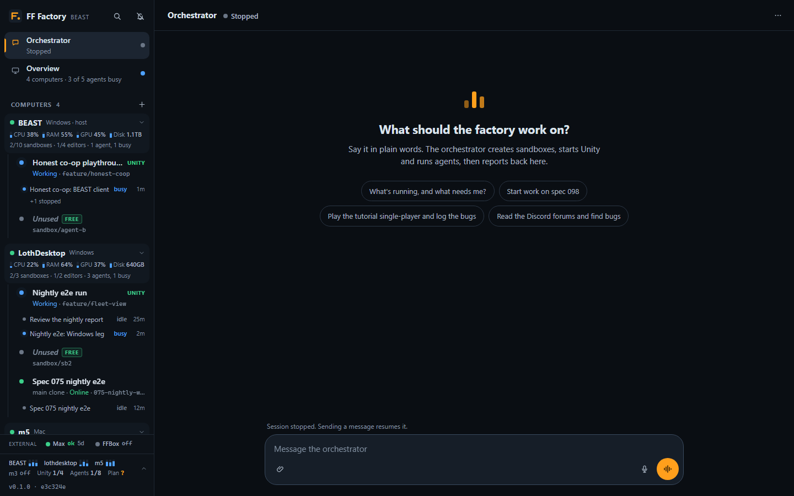
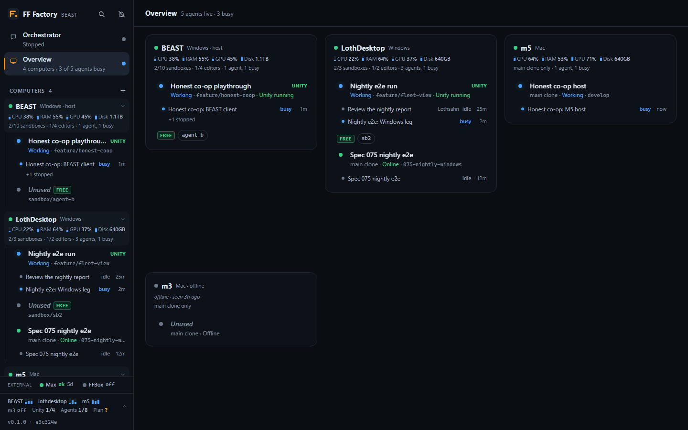

# Machines: agents on the user's Macs and Windows PCs

A machine is a whole computer the portal can run agents on. The portal itself runs only the orchestrators and the
dispatcher (w510, 2026-10-06): every worker, sandbox, Unity editor and standing agent runs under a machine's daemon,
and the portal's own computer can be one too ([beast-machine.md](beast-machine.md)). Every worker runs in one of
a machine's sandboxes, worktrees of its main game clone in its `sandbox_root` ([Machine sandboxes](#machine-sandboxes));
no agent works in the main clone, the one the user uses (w536). Machines are Macs (the daemon is a LaunchAgent), Windows PCs (the
daemon is a scheduled task at the user's logon, [below](#windows-machines)) or Linux PCs (a systemd user service, installed on
the PC with its worker installer only: [worker-install.md](worker-install.md#linux)), with ids such as `m5` or
`lothdesktop`. Ids are lower-case letters, digits and dashes; one given with capitals (`LothDesktop`) is
stored lower-case and shown as typed, and either spelling works in every tool.

The rest of this page describes the Macs; [Windows machines](#windows-machines) says what differs.

## Requirements

| | on each Mac |
|---|---|
| Reachable | `ssh <host alias>` from the portal host with an existing key, no password prompt |
| Game clone | a clone of the game repo (the one in config `repo.url`) under the home folder, found by its `origin` URL, or pass its path to `add_machine` |
| Claude Code | installed for the user. Portal-run agents run on a vault token (w1078), so a login is not needed for them; the user's own sessions keep theirs |
| node | 22.6 or newer (versions without native TypeScript support run with `--experimental-strip-types`); the newest node on the PATH the user's own zsh sets up, or in common install locations, is used |
| Portal URL | a public URL for the portal, e.g. the Tailscale Funnel URL `https://<host>.<tailnet>.ts.net` (config `publicUrl`, or given to `add_machine`) |
| Sleep | set to never, or agents stop when the Mac sleeps (the daemon holds `caffeinate -i` only while agents run) |

A Windows PC needs the same (reachable over ssh with a key, a clone, Claude Code, node 22.6+) plus git and
OpenSSH Server: its owner's checklist is in [Setting up a Windows PC](#setting-up-a-windows-pc-for-its-owner).

The portal can listen on `127.0.0.1` only. The Macs reach it through its public URL, not a tailnet IP.

Files people attach to messages reach a machine's agents through its daemon, which fetches each one from the portal
with its machine token into `Inbox/` of the agent's working folder before the message goes on (protocol 7,
[attachments.md](attachments.md#machines)).

## Design: a daemon that connects out

Each Mac runs `machine/daemon.ts` as a **LaunchAgent** (`com.fffactory.daemon`, in the user's GUI
session). It opens a WebSocket to `wss://<portal>/machine` with a per-machine token, and runs Agent
SDK sessions locally with the same `AgentSession` code the portal uses, streaming every transcript
event and session update back. The portal keeps the record (state.json, transcripts) exactly as for
sandbox workers, so the UI, the orchestrator's tools and transcripts do not care where an agent runs.

Why not drive sessions over ssh: an ssh session cannot read the login keychain, so Claude Code on
a Mac often looks logged out there, and an ssh connection dies with every sleep or network change. A
LaunchAgent runs in the logged-in session (keychain, the user's `claude` and plugins), starts at
login, restarts if it dies, and reconnects by itself: every ~2 s for the first two minutes after a drop
(a portal restart takes 20-60 s; a refused attempt, such as the proxy's 502 while the portal is down,
ends at once), then backing off to 30 s; a ping every 20 s, and a dead connection is dropped after 45 s
without a pong. If a daemon still has not come back 2 minutes after the portal started or after it
dropped, and its Mac answers ssh, the portal redeploys it by itself (as `add_machine` does), at most
every 30 minutes and never while its agents are running. So after a restart, give daemons a minute
before redeploying by hand.

- **Auth.** A 256-bit token per machine; the portal keeps only its SHA-256 (state.json) and compares
  in constant time. `/machine` is on the public Funnel URL, so a bad token is logged and throttled.
- **Sessions.** The portal creates the session record and tells the daemon what to launch (a
  serialisable launch spec: cwd, model, brief, tools, guard settings, budget). Transcript sequence
  numbers are assigned by the daemon, starting from the portal's last one, so a session resumes
  across daemon restarts. An agent whose machine is offline shows `stopped`; messaging it fails with
  "machine m5 is offline". **Cut off mid-turn:** when a machine's link drops, the portal notes the workers that
  were mid-turn; when the daemon is back without them (it was redeployed with `add_machine` `force`, restarted
  with `machine_daemon restart`, or crashed), each gets a resume message (check git status, re-pin Unity,
  continue), as after a portal restart, and the orchestrator hears which. After a network blip they are still
  running, so nothing is sent; `machine_daemon stop` is on purpose and resumes nobody; after more than 6 hours
  the orchestrator is told instead. A daemon going down stops its agents keeping their mid-turn mark
  (`stop(false)`), which is how the portal knows. Only workers the daemon reported live on the link that dropped
  (its hello or a session report, `seenLive`), mid-turn and active within those 6 hours count (`cutOffMidTurn`):
  the portal's own marks and activity times never suffice on their own, whatever the daemon's version. A report
  without `turnOpenSince` clears the portal's copy (JSON drops cleared fields), a drop clears every mark it has
  noted, and a refused start (`failed`) does not move `lastActivityAt`. An agent stopped or interrupted on purpose
  (`stop_agent`, the UI) is marked `stoppedOnPurpose` (saved, and taken off any cut-off list already noted) and is
  never resumed, by a dropped link or a portal restart, until it is sent a message again.
- **Offline with work waiting (w1249).** A machine offline 30 minutes (`OFFLINE_ALERT_MS`; its `lastSeen` counts from
  before a portal restart) with work stranded on it (agents cut off mid-turn, workers it holds a sandbox for, messages
  queued for it: `strandedOn`) is told once per outage to the orchestrator and pushed to the host's devices
  (`notifier.host`), naming the stranded work; its return is told too. Worker-root installs count, which the ssh
  redeploy skips. A stopped, relocated or not-yet-installed machine, or one with nothing waiting (a person's own Mac
  asleep), is not. Why: the m3 panicked 7 times in 2026-10-07..13 (a GPU page fault in game clients workers ran there)
  and each time sat at its FileVault unlock screen for up to 14 hours, unnoticed, with workers stranded on it.
- **Tools.** Workers get the machine's tools (`wake_me`, `unity`, `read_work`, …) via a `machine` MCP server
  whose calls go back to the portal. Which ones is the tool manifest's `worker` kind ([tool-manifest.md](tool-manifest.md),
  w1163): all of them are deferred (measured: carrying any costs workers more than the lookups it saves), each with its
  group as a `ToolSearch` hint, so `select:<name>` loads one and `group_<group>` a group; the brief says so. They set no label: their title says what they are doing, and the dispatcher sets it
  ([orchestrators.md](orchestrators.md#worker-titles-and-sandbox-labels), w575).
- **The main clone is the owner's** (w536): the daemon runs no editor, hang/crash watch, Unity MCP place, Unity slot
  place or git status report for it. A `unity` or `switch` message without a sandbox (from an older portal) is answered
  "a machine's main clone takes no agents (w536): give a sandbox", and `status_now` with nothing. A person's own editor
  there still counts against `max_unity`, as started outside the gate; it does not stop a request that must change the clone:
  one that explicitly asks for work there carries the person's grant (`mainCloneAccess`, [orchestrators.md](orchestrators.md#work-in-a-machines-main-clone-w936)),
  and its worker closes the editor cleanly, backs up, fetches and checks out, and reopens Unity there, no person asked to
  (w935 and w936, Ben: "You can close Unity."). The machine record's `git` is only what a daemon
  from before w536 last sent; `list_machines` and the machine page leave it out when there is none.
- **Guard.** The workers' guard runs in the daemon (the sandbox rules, [below](#machine-sandboxes)). The
  backup-before-discard rule for the user's own clone (2026-09-25: copy local changes to `ff-local-backups/` beside
  the clone before setting any aside) went with main-clone workers (w536): no agent works there now, and the main
  clone is a protected path for sandbox workers. Existing `ff-local-backups` folders stay, and the clean-up never
  deletes them. Force pushes and direct pushes to the game repo's master/main (and to its retired develop) stay refused; master takes a PR. The daemon's own folder
  (`~/.ff-factory`, or the machine's `app_dir`; it holds the token) is protected.
- **Claude account.** Every run on a machine, a Mac's included, gets a vault token from the run person's pool (highest score
  first, the weekly headroom per hour to its reset, within the pool's caps; not one inside the dispatcher's reserve while
  another has room), and the other secrets granted to that machine, in the same launch spec ([vault.md](vault.md)). Since
  w1078 there is nothing else: no host token in config, no Mac login, and `machines.useHostClaudeEnv`, `machines.claudeFromVault` and
  `userClaudeEnv` are retired and taken out of config.json at the portal's start ([accounts.md](accounts.md)). The portal puts
  the token in the launch spec, sent over the authenticated daemon connection with each start; the daemon passes it to that
  agent's Agent SDK process only (it overrides the Mac's keychain login for that process), and drops any credential in its
  own environment for that agent (`LaunchSpec.login`, always set). It is never written to disk on the Mac, the daemon log
  redacts tokens, and transcripts are redacted (server/secrets.ts). The user's own interactive Claude Code sessions on the Mac
  are unaffected: they keep the Mac's login, but no portal-run agent uses it. `list_machines` and a sandbox worker's brief say
  "a vault token from the pool of the person the work is for", and the brief names the token ("vault token vault-ben-1
  …abcd"). A person with no usable token waits (a held pool) or the run does not start and says why. An agent already
  running keeps its token until its process restarts; after an update the daemons are redeployed anyway.
- **Limits.** **Workers run in sandboxes only** (w536, Lothsahn on 2026-10-06: "Can't we get rid of this code so the
  settings doesn't matter?"): `start_agent` with a machine alone is refused, naming its sandboxes, the Capacity block
  lists sandbox computers only, and the daemon refuses any agent whose folder is the main clone (`mainCloneRefusal` in
  `server/machines.ts`, `startRefusal` in `machine/daemon.ts`). A machine without sandboxes (the m3, the m5) takes no
  workers: it gets a sandbox root through its worker-root install ([worker-root.md](worker-root.md), w513). Each
  machine has **one agent cap** (`agentCap`): its sandboxes' agents and its standing agents mid-turn together, at most
  `max_sandbox_agents`, else every sandbox full (`max_sandboxes` × `max_agents_per_sandbox`); a machine without
  sandboxes runs up to 2 standing agents (`STANDING_CAP_NO_POOL`). Each sandbox has its own limit too
  (`max_agents_per_sandbox`, below). `max_agents` is gone: the portal drops it from an old record at start and says so
  once, and a daemon whose `daemon.json` still has `maxSessions` logs that it is obsolete (the portal's `welcome` sends
  the cap in that field, so an older daemon keeps working). The portal has no worker limit of its own: it runs none
  (`limits.maxSessions` and `limits.maxIdleAgents` are retired). The limits count agents
  mid-turn only, and a message that finds them full waits in the portal's queue instead of being refused; the daemon's
  own start check counts the same way, and idle finished workers are stopped by the portal's reaper
  ([orchestrators.md](orchestrators.md#agent-limits-and-idle-workers), w384).
- **Awake.** While any agent process is live the daemon holds `caffeinate -i`.
- **Clean-up.** The daemon cleans its machine's disk by itself (the continuous clean-up,
  [self-recovery.md](self-recovery.md#5-continuous-clean-up)): a pass every hour, every 15 minutes while
  free space is below its soft threshold (20 GB by default, w1951; config `machines.cleanup.softFreeGB`, BEAST 40), with the rules for its platform; below it, it also removes
  FF Factory's own leftovers by itself (player slots nobody holds, pushed agent worktrees, unused Unity editors:
  [self-recovery.md](self-recovery.md#ff-factorys-own-leftovers-w626), w626). Each agent
  gets its own temp folder (`ffa-<session>` under `temp_dir` or the system's temp), removed when the
  session is removed or two hours after it stopped. The portal sends the settings at connect and when they
  change (`cleanup_config`; config `machines.cleanup.everyMinutes` / `.softFreeGB`, per machine with
  `set_app_config ... machine: "<id>"`); the daemon keeps them in `cleanup.json` in its folder, so it goes on
  while the portal is down. After each pass it reports a summary (`cleanup`), shown by `list_machines` and
  the dashboard's meters; one that cannot get back above the soft threshold also tells the orchestrator,
  with the biggest remaining consumers. Every pass is logged to `cleanup-log.jsonl` in the daemon's folder. On a machine with a
  worker install (`root`), clean-up removes only what is inside the install folder; what its rules pick outside it is measured
  and listed ([self-recovery.md](self-recovery.md#where-clean-up-may-delete-w896), w896), except on Windows, where nothing
  off the install drive (C:) is read, measured, listed or named in a notice, and a worker's scan there is refused, apart from
  reading the game's AppData `Never Games` folders, which nothing modifies
  ([self-recovery.md](self-recovery.md#windows-the-install-drive-only-w1755), w1755).
  `machine_cleanup` runs a pass now.
- **Standing agents** run on a machine and need one ([standing-agents.md](standing-agents.md)): their folder is `agents/<id>` in the daemon's folder
  (`~/.ff-factory/agents/<id>` by default) on that Mac, runs wait (like a full slot) while the machine is offline, and budgets work unchanged.

## Setup and updates, from this host

`add_machine` (orchestrator tool, and a button in the UI) does everything over ssh with this host's
existing keys: finds node (≥ 22.6) and the FF clone, copies the portal's own code
(`git archive` of `server/ shared/ machine/ package*.json`) to `~/.ff-factory/app`, runs
`npm ci --omit=dev`, captures the user's own zsh PATH (login + interactive, so the LaunchAgent sees what their
terminal sees, e.g. `~/bin/gh`), writes `~/.ff-factory/daemon.json` (portal URL, name, token, repo path,
`claude` path) and the LaunchAgent plist, and (re)loads it: `launchctl bootout`, a wait of up to 30 s until the
old daemon has gone (`launchctl print` fails), then `launchctl bootstrap gui/<uid>`, retried up to 5 times
(`macReloadLines`; a bootstrap into a service still loaded fails with "5: Input/output error" and left m3 with no
daemon, 2026-09-29).
Running `add_machine` again for the same id (or Redeploy in the UI) updates the code and issues a fresh
token; it refuses while agents are running there unless forced. The user does nothing on the Macs.
The deploy counts the new daemon as connected from the start of its install step (launchd starts it before the
ssh session returns) or by its hello naming the version installed. A daemon's hello clears any install or
connection error on its machine (a connected machine never shows "error"); a redeploy that fails while a
daemon is still connected leaves the machine ready, with "the last redeploy failed, …" as its detail; a deploy
cut short by a portal restart shows as an error at boot rather than staying "deploying".

**A machine's own folders.** `add_machine` (and the Add machine form) takes four optional absolute paths (and
`sandbox_root`, [below](#machine-sandboxes)),
kept on the machine's record (shown by `list_machines` and on the machine page) and in its `daemon.json` (every path a
worker machine uses today, and the plan to put them all under one root folder: [worker-root.md](worker-root.md), w511):

| Option | What it sets | Default |
|---|---|---|
| `app_dir` | The daemon's folder: `app/` (the code), `logs/`, `agents/` (standing agents), `daemon.json`, `outside-watch.json`, the public-repo identity | `~/.ff-factory` (`%USERPROFILE%\.ff-factory`) |
| `unity_editor_root` | A folder of Unity versions, searched first: `<root>/<version>/Unity.app` on a Mac, `<root>\<version>\Editor\Unity.exe` on Windows | Unity Hub's folders |
| `unity_path` | The Unity editor executable itself, used whatever the project's version | the lookup |
| `temp_dir` | `TMP`, `TEMP` and `TMPDIR` of its agents' processes (made if missing) | the system's |

On a redeploy an option left out keeps its value and `""` clears it. A path for the other OS is refused
(`checkDirs`). On a Mac with an `app_dir` the deploy writes there and the LaunchAgent runs
`<app_dir>/app/machine/daemon.ts <app_dir>/daemon.json`, logging to `<app_dir>/logs/daemon.log`. The guard
protects the `app_dir` as it protects `~/.ff-factory`. Moving it leaves the old folder's files in place (delete
them by hand); the old LaunchAgent is replaced as on any redeploy.

**Finding Unity** (`editorBinary` in `machine/unity.ts`, both OSes): `unity_path`; else the project's version
(`ProjectSettings/ProjectVersion.txt`) in `unity_editor_root`; then the editors Unity Hub lists in its settings
folder (`editors-v2.json`, or the older `editors.json`: editors the Hub was pointed at, anywhere); then the
install location chosen in the Hub (`secondaryInstallPath.json`); then the Hub's defaults
(`/Applications/Unity/Hub/Editor`, `~/Applications/Unity/Hub/Editor`; `Program Files\Unity\Hub\Editor`). The
Hub's settings folder is `~/Library/Application Support/UnityHub` on a Mac and `%APPDATA%\UnityHub` on Windows,
so a Hub whose install location is, say, `C:\Program Files\Unity\Editor` needs no option.

**Load and usage (protocol 4).** Every 15 s the daemon reports its Mac's CPU, RAM, GPU and disk
(`stats`, measured by `server/system.ts` as the portal measures its own host: RAM from `vm_stat` and
memory pressure, the GPU from `ioreg`), and every config `usagePollMinutes` (default 15; [accounts.md](accounts.md#how-often)) the plan
usage of the Mac's own Claude login (`usage`, the same promptless usage request the portal makes, with
no token in its environment). The portal keeps the load in memory only (not in state.json) and drops
it when the machine goes offline; the sidebar footer and `system_status` show every machine. The usage
is not listed in the usage meters since w1078 (no portal-run agent runs on that login; [accounts.md](accounts.md)), though the daemon still reports it. A
daemon from before protocol 4 sends neither; the machine shows "no numbers yet" until the usual
redeploy of outdated daemons updates it.

**Worker root installs** (w513, [worker-install.md](worker-install.md)): a machine installed on the computer itself with
`scripts/worker/install.ps1` or `install.sh` keeps everything under one root, reports it in its hello (`layout`), and is
never redeployed over ssh: when it is outdated, the portal says once to re-run its installer there; one with an update available is
updated by the portal's own rollout after a verified deploy ([ops-worker.md](ops-worker.md#after-a-verified-deploy-w887)).

**Versions** (w605). A daemon is versioned by the protocol it speaks (`PROTOCOL_VERSION` in
`server/machineProtocol.ts`), not by the commit it was installed from. Its hello reports the protocol, the oldest portal
protocol it still serves (`oldestPortal`), the commit (`machine/VERSION`, stamped by a deploy or the installer) and the
tools it can serve.

- **Update available** (`MachineManager.updateAvailable`, `daemonBehind`): another commit, a protocol in range. This is
  every machine right after a portal update. The machine shows "update available: it runs <commit>, this portal
  <commit>" and works exactly like a current one: it takes new agents, starts them, and resumes paused and cut-off ones
  (a restart's resume and `resumeCutOff`). Before w605 it counted as outdated, and after the update of 2026-10-07
  (portal 280ce85 to 9ea8476, every daemon on f3f19c0) the portal would not resume five paused agents until each
  installer was re-run. A worker root install is updated by FF Factory itself after a verified portal deploy ([ops-worker.md](ops-worker.md#after-a-verified-deploy-w887)), with no drain or wait: agents run on through it. Any that stays behind is told once, and `ops_worker machine_update` updates it. A daemon the portal
  deployed over ssh is redeployed by the portal once nothing runs there: no live process, no agent mid-turn by its
  record, none waiting to be resumed (checked on its hello and every 30 s, at most every 10 minutes per machine).
- **Outdated** (`MachineManager.outdated`, `protocolProblem`): a protocol out of range. The portal drives daemons from
  `OLDEST_DAEMON_PROTOCOL` (7) up, gating each newer feature on the daemon's own protocol (`SANDBOX_PROTOCOL`,
  `ATTACHMENT_PROTOCOL`, `RELOCATE_PROTOCOL`), and a daemon says in `oldestPortal` how old a portal it serves (7), so
  either side may be one protocol ahead. Only an outdated daemon refuses new agents and resumes. The portal redeploys
  one by itself as soon as no agent runs there and tells the orchestrator. Meanwhile a plain message that would start a
  new agent there is refused with "<id>'s daemon is outdated (...); redeploying it now. Try again in a few minutes.",
  but a worker's first prompt from `start_agent` (its brief) waits in the send queue and goes as soon as the daemon can
  take it (w496, [orchestrators.md](orchestrators.md#agent-limits-and-idle-workers)). Agents already running carry on.
  After an app update, agents on a machine with an outdated daemon are resumed only once it is redeployed
  (`whenCurrent`, up to 12 minutes); the orchestrator gets a `[machines]` line saying which ones resumed.

**Changing the protocol.** `server/machineProtocol.test.ts` fingerprints what the two sides send each other (the
messages in `machineProtocol.ts` and `LaunchSpec` in `launch.ts`, comments and spacing left out) and fails on any
change until someone decides: a change both sides ignore safely (a new optional field, a message the other side drops)
records the new fingerprint; one an older side would misread bumps `PROTOCOL_VERSION` and is gated on the daemon's
protocol in the portal. Measured with it: between f3f19c0 and 9ea8476 the surface changed once, w536 dropping the
optional `guard.ownCheckout`, which an older daemon reads as absent, so no bump. The daemon also leaves out any MCP tool
its own code does not know, so a newer portal cannot crash an older daemon's launch.

### Agents outlive their daemon

(w605, lothsahn: "can we make it so that the install doesn't require shutting down running jobs, and it can just attach
back to them?") Each agent process runs in an **agent host** (`machine/agentHost.ts`): a node process of its own that
the daemon starts detached, which runs the AgentSession (the Agent SDK's query, its permission prompts, the guard hooks)
and so the `claude` process and everything it starts. A daemon restart, an update, a reinstall or a daemon crash leaves
it running, mid-turn or idle. The next daemon takes it back.

- **Why detached** (measured on BEAST, 2026-10-07, with a throwaway scheduled task): the daemon's whole tree runs
  inside Task Scheduler's job object, whose limits are none (no kill on close), and `Stop-ScheduledTask` ends only the
  task's own process. What ended the agents was node itself: a plain child of node is in node's own kill-on-close job and
  dies with it, while a `detached` child lives on. On a Mac a detached child gets a session and process group of its
  own (setsid), so launchd's stop of the daemon's process group does not reach it (`launchd.plist(5)`,
  `AbandonProcessGroup`; the same way the Unity editor outlives a daemon restart there).
- **Files, not pipes.** The two talk only through append-only files in `<appDir>/hosts/<session id>/`, one writer
  each: `in.jsonl` (the daemon's numbered commands: send, interrupt, stop, mode, decide, tool answers, the editor's
  state), `out.jsonl` (everything the session records, in order: its record, transcript events with their seq set in
  the host, images, deltas, signals, tool calls), `daemon.offset` (how far the daemon forwarded `out.jsonl` to the
  portal), `host.json` (pid, host protocol) with `beat` (its heartbeat every 3 s), `state.json` (its last record),
  `place.json` (its folder and sandbox) and `host.log`. A new daemon forwards exactly what the last one had not, so the
  portal's transcript has no gap and no event twice.
- **No secrets on disk.** The launch spec holds the run's tokens (vault), so it reaches the host on its stdin at
  start and is never written down. A host therefore lives exactly as long as its agent process: through idle time
  between turns, until the process ends (a stop, the portal's idle reap, the agent's own end). The next message then
  starts a new host that resumes the conversation. Everything a host writes passes `redactValue` first.
- **Tools** (`wake_me`, `unity`, attachments...) are asked of the daemon through the files and answered by the portal
  as before. A tool call the old daemon took but never answered is asked again of the next one (`attach`).
- **Adoption.** At its start, before its hello, the daemon reads `hosts/`: a host whose pid exists and whose heartbeat
  is fresh is taken back and listed live in the hello (so the portal's `resumeCutOff` leaves it alone). One that is
  gone has what it recorded forwarded, and its session is not live: the portal resumes it with its conversation if it was
  mid-turn (as for any agent cut off), and its next message starts a new host otherwise. A host of another host protocol
  (`HOST_PROTOCOL`) is left running and not adopted.
- **An adopted host runs the code it started with** (w1166). Its guard hooks and the system prompt of its launch spec
  are in its memory, so an update does not reach them: on 2026-10-12 the update to ba015be (#359, the game's develop
  retired) adopted every host at 21:30-21:37 UTC, and workers started before it kept the old guard and the old "develop
  is the integration branch" prompt. w1145's worker (ffe7fcc1 on BEAST, started 21:04) opened game PR #1580 with
  `gh pr create --base develop` at 22:33, which the new guard refuses; w1147's (lothdesktop, started 21:06) merged #1579
  into develop at 23:20. So the portal records the daemon commit each worker process started on (`SessionInfo.ranOn`,
  from the hello), and a worker whose machine now runs another commit restarts on it at its next turn boundary, in the
  same conversation (`SessionManager.codeMove`, `Agents.codeMove`, the account move's path: its message waits until the
  old process has stopped). Never mid-turn and never while a background task runs (a build the restart would kill): that
  message reaches the running process, and the restart comes with a later one. The first message of a process on other
  code than its last opens with an `[updated]` line (`updatedNote`): its system prompt and guard are the current ones,
  and where they differ from what it read earlier in the conversation, they win.
- **A host's end** (w799, BEAST 2026-10-09: the daemon dropped two hosts whose heartbeats were 30 s late under a release
  build while their processes ran on; it could not remove their folders, `EPERM` on Windows, and never ended them. One,
  w790's worker 38a203f0 in slot1, ran half an hour more with its claude.exe and Unity MCP chain, its `publish_attachment`
  call never read, while the portal gave slot1 to a new worker; its next message failed on the same `EPERM` and errored
  it.) Now (`machine/hostWatch.ts`):
  - A host is its **pid and start time** (`host.json` `startedAt` against the process's own start, within 90 s), so a
    reused pid is never taken for it or killed.
  - A **late heartbeat with the process alive is not an end**: the host is kept, read and answered on; silent for 5 min
    (`HOST_WATCH.HUNG_MS`) it is stopped. Only a gone pid (or one that is another program now) ends it at once.
  - **Ending a host** ends its whole process tree (`taskkill /T /F`; on a Mac or Linux its process group and every
    descendant), waits until it is gone, and only then removes its folder, retrying `EPERM`/`EBUSY` with back-off (node's own
    `rmSync` retries miss Windows' access-denied before Node 24.21). A host that closed by itself gets 10 s to exit first. A
    host is started with the hosts folder as its working directory, not its own folder, which Windows would then refuse
    to delete. A message sent meanwhile starts the new host once the old one is gone.
  - **The host watch** looks every minute at every host folder the daemon does not follow: a host whose process runs
    (pid and start time) is an orphan, and on the second look in a row it is stopped the same way, its folder removed and
    the orchestrator told (a `sandbox_event`). The folder of a host long gone is removed 6 h after its last write (kept
    that long for a post-mortem; the portal has the transcript).
  - **No slot twice.** While an old host's tree is being stopped (or is still closing after the portal dropped its
    session) its sandbox is reported with `lingering`: the portal does not count it FREE (`list_sandboxes` says why) or
    place a released worker there, and the daemon refuses a new agent there. That session's own next message waits for it.
  - **Tool calls always end.** A handler that throws at once is answered with its failure; a host gives up on a call
    its daemon has not answered in 20 min (`RPC_ANSWER_MS`) and tells the agent, instead of waiting forever.
- **Stops.** `Stop-FFDaemon` (Windows) spares the agent hosts and what they run, as it spares Unity, unless `-Agents`:
  a reinstall and a restart (`installScript`, `machine_daemon restart`) keep them, and a stop and the uninstall end them.
  On a Mac `launchctl bootout` stops only the daemon; a stop and the uninstall then `pkill` this daemon's hosts. The
  portal lets a daemon that says `agentHosts` in its hello restart while agents run (`controlDaemon`).
- `agentHosts: false` in daemon.json runs agents inside the daemon as before (they end with it).
- Tests: `server/agentHost.test.ts` runs a real daemon process and real hosts with the scripted fake agent, kills the
  daemon mid-turn and starts another (Linux and Windows in the checks job; CI has no macOS runner yet), and kills a host to
  see its agent resumed. `machineDeployWin.test.ts` runs the real `Stop-FFDaemon` against stand-in processes.
  `server/hostWatch.test.ts` (w799) runs stand-in hosts (a node working in its host folder, with a child): the locked
  folder on Windows, a late heartbeat kept and answered, an orphan stopped on the second look, a reused pid left alone;
  `agentState.test.ts` checks the slot-reuse guard from the daemon's report to the portal's FREE.

## Windows machines

A Windows PC is a machine like a Mac: same daemon, same protocol, same guard, same tools. `add_machine`
finds out over ssh which OS it is talking to (`detectPlatform` in `server/machineDeploy.ts`: `uname -s`
answers on a Mac; on Windows, PowerShell does) and records it (`platform`, also reported in the daemon's
hello). `list_machines`, the sidebar and the machine page show it.

**How the portal talks to it.** Windows OpenSSH Server hands a command to its default shell, cmd.exe or
PowerShell, and the two quote differently. So the command line is only
`powershell.exe -NoProfile -NonInteractive -ExecutionPolicy Bypass -EncodedCommand <base64>` (the same under
either shell), a small bootstrap that reads the real script from stdin as UTF-8 up to a `#FFEND` line and runs
it (`server/machineDeployWin.ts`). It never waits for EOF on stdin: on some PCs (Windows 11, cmd.exe as the default
shell) that read never returns once a few KB came in, and stdin through sshd stalls altogether after ~200 KB. So
the code bundle goes by `scp` into the user's home, and the upload script unpacks and deletes it. Nothing
depends on which default shell is set.

**What a deploy does** (all in `%USERPROFILE%\.ff-factory`, the same folder as on a Mac, or in the machine's
`app_dir`, e.g. `D:\work\.ff-factory` on a PC with several drives; see "A machine's own folders" above):

1. Probe: the user's SID and home, the newest node (the PATH, then nodejs.org, nvm-windows, Volta, fnm and
   Scoop installs), Claude Code's native `claude.exe` (an npm `claude.cmd` shim cannot be started by the Agent
   SDK, which then uses its own bundled Claude Code), git, System32's `tar.exe`, whether the user is logged on,
   and the game clone: a clone of config `repo.url` under the home folder (3 levels deep, not AppData) or
   near the top of any fixed drive (2 levels, e.g. `D:\FinalFactory` or `D:\dev\FinalFactory`).
2. Copy the portal's code (the same `git archive` of `server/ shared/ machine/ package*.json`, as a .tar.gz)
   into `app.new`, unpacked with System32's tar; `npm ci --omit=dev` with that node's own npm.
3. Stop the old daemon, `app` → `app.old`, `app.new` → `app`, write `daemon.json` (portal URL, id, token,
   repo path, claude path, the folder options) and `run-daemon.ps1`, register the **`FFFactoryDaemon`**
   scheduled task (its action and working folder in the daemon's folder) and start it. The stop looks for a
   daemon running from the daemon's folder, the default one and the previous deploy's `app_dir`, so moving the
   folder does not leave the old daemon running.

**What runs it.** The task starts at logon of that user (trigger and principal by SID), in their interactive
session (the Claude login, the GPU and the desktop Unity needs), not elevated (`LeastPrivilege`), at normal
priority (a task's default 7 would give every agent and Unity below-normal CPU, I/O and memory priority), with
no time limit and no battery or idle conditions. Its action is `conhost.exe --headless powershell.exe -WindowStyle
Hidden -File run-daemon.ps1` (headless since w603: with Windows Terminal as the default terminal, `-WindowStyle
Hidden` alone left a Terminal window open on the desktop for as long as the daemon ran), a supervisor like the portal's own `scripts/supervise.ps1`: it starts
`node machine/daemon.ts <daemon.json>` hidden, and again whenever it exits (10 s, doubling up to 5 minutes
while it keeps dying within 5 minutes). Its output is in `logs\daemon.log` and `daemon.err.log` in its folder
(the previous run's in `*.prev`), the supervisor's own lines in `supervisor.log`. Task Scheduler restarts the
supervisor itself if it fails.

**Start, stop, restart.** `machine_daemon` (orchestrator tool, and Restart/Start on the machine page) runs
over ssh: stop disables the task, ends it, kills the supervisor and the daemon with everything they started
(agents and their shells, but never a Unity editor or Unity Hub, which outlive a daemon restart as on a Mac),
and enables the task again, so it starts at the next logon; start runs the task. Stop and restart are refused
while agents run there unless forced, as is a redeploy; a daemon stopped this way is left alone by the
offline redeploy until it is started or redeployed. On a Mac the same tool unloads, loads or kickstarts the
LaunchAgent. `remove_machine` stops the daemon and deletes the task; the files stay.

**Only while someone is logged on.** The daemon lives in the user's session: it starts when they log on
(a locked screen is fine) and stops when they log off. After a reboot (Windows Update) it is back once they
log on again. A deploy while nobody is logged on installs everything and says so: the machine shows
"installed, but nobody is logged on".

**On the machine.** The daemon is the same code as on a Mac, with these differences:

- **Awake**: while any agent runs it holds `SetThreadExecutionState(ES_CONTINUOUS | ES_SYSTEM_REQUIRED)`
  from a hidden PowerShell that waits on the daemon's pid (so a crashed daemon cannot keep the PC awake).
  The display may still turn off; set sleep to never anyway (below).
- **Load**: `server/system.ts` as on the BEAST host: CPU, RAM, disk, and the GPU: through `nvidia-smi` when it is
  there, else (an Intel or AMD card) from Windows' own performance counters, `\GPU Engine(*)\Utilization Percentage`
  (the busiest engine, summed over the processes using it, as Task Manager shows it) and `\GPU Adapter
  Memory(*)\Dedicated Usage`, read with Get-Counter (their CIM classes on a Windows whose counter names are
  localized), with the adapter's name and memory from the registry (`WIN_GPU_SCRIPT`, `parseWinGpu`).
- **Unity**: a sandbox's `unity` tool and hang/crash watch work as on a Mac (`machine/unity.ts` with platform
  win32): the editor is `Unity.exe` with `-projectPath` of the sandbox, found as above ("Finding Unity":
  `unity_path`, `unity_editor_root`, the editors the Hub lists, its chosen install location, Program Files); its
  log is
  `%LOCALAPPDATA%\Unity\Editor\Editor.log`. The editor is launched through `Start-Process` so that it is
  nobody's child and outlives a daemon restart. The dialog watch reads and presses Unity's windows with
  `scripts/unity-windows.ps1` ([unity-dialogs.md](unity-dialogs.md#macs)). No App Nap.
- **Guard**: the same rules. Killing `node.exe` or `claude.exe`, and ending, changing or deleting the
  `FFFactoryDaemon` task (`schtasks /End|/Change|/Delete`, `Stop-/Disable-/Unregister-/Set-ScheduledTask`) are
  refused, and killing Unity by hand is refused as in every sandbox (the `unity` tool restarts an editor). The daemon's folder (`.ff-factory`, or the
  `app_dir`) is protected in every spelling (`C:\Users\x\.ff-factory`, `~/.ff-factory`, `%USERPROFILE%`,
  `$env:USERPROFILE`, Git Bash's `/c/Users/...`; `D:\work\.ff-factory`, `D:/work/...`, `/d/work/...`).

### Setting up a Windows PC (for its owner)

Once, on the PC, as the user whose desktop the agents should run in. Commands are for an **administrator**
PowerShell unless it says otherwise.

1. **Tailscale.** Install it from tailscale.com and sign in. The portal host (BEAST) must reach the PC over
   the tailnet: either join Ben's tailnet (Ben sends an invite), or keep your own tailnet and share the
   machine with Ben (admin console → the machine → Share). Nothing is needed the other way: the daemon reaches
   the portal at its public URL.
2. **OpenSSH Server**, started now and at every boot:

   ```powershell
   Add-WindowsCapability -Online -Name OpenSSH.Server~~~~0.0.1.0
   Set-Service -Name sshd -StartupType Automatic
   Start-Service sshd
   # Recommended: PowerShell as the ssh shell (cmd.exe, the default, works too).
   New-ItemProperty -Path 'HKLM:\SOFTWARE\OpenSSH' -Name DefaultShell -Value 'C:\Windows\System32\WindowsPowerShell\v1.0\powershell.exe' -PropertyType String -Force
   ```

   The installer adds a firewall rule for port 22 (`Get-NetFirewallRule -Name OpenSSH-Server-In-TCP`).
3. **BEAST's public key.** Ben sends the one-line public key of the portal host (its `id_ed25519.pub`).
   Where it goes depends on your account, which is the quirk to watch for: **for a member of the
   Administrators group, OpenSSH ignores `~\.ssh\authorized_keys`** and reads only
   `C:\ProgramData\ssh\administrators_authorized_keys`, which must be writable by Administrators and SYSTEM
   only:

   ```powershell
   # An administrator account:
   Add-Content -Path C:\ProgramData\ssh\administrators_authorized_keys -Value '<the key Ben sent>'
   icacls.exe C:\ProgramData\ssh\administrators_authorized_keys /inheritance:r /grant 'Administrators:F' /grant 'SYSTEM:F'
   # A standard account instead (in that user's own, non-admin PowerShell):
   New-Item -ItemType Directory -Force $env:USERPROFILE\.ssh | Out-Null
   Add-Content -Path $env:USERPROFILE\.ssh\authorized_keys -Value '<the key Ben sent>'
   ```

   Your ssh user name is what `whoami` prints after the backslash (with a Microsoft account, the local
   account name, usually your folder under `C:\Users`).
4. **Tools**, then log in to Claude Code and clone the game, in a normal (not administrator) terminal:

   ```powershell
   winget install OpenJS.NodeJS.LTS      # node 22.6 or newer
   winget install Git.Git                # git and Git Bash (Claude Code needs it); includes git-lfs
   irm https://claude.ai/install.ps1 | iex   # Claude Code, the native claude.exe
   # A new terminal, then:
   claude                                 # log in once, then /exit
   git lfs install
   git clone https://github.com/Final-Factory/FinalFactory.git D:\FinalFactory   # or under your home folder
   ```

   Clone from a normal terminal: a clone made from an administrator one is owned by Administrators, and git
   in the (non-elevated) daemon then refuses it as "dubious ownership". For Unity work, install Unity Hub and
   the project's Unity version (ProjectSettings\ProjectVersion.txt) in the Hub's default or chosen folder
   (the daemon reads the Hub's choice). Unity installed elsewhere, or files on another drive: give `add_machine`
   `unity_editor_root` or `unity_path`, `app_dir` and `temp_dir` (above).
5. **Never sleep** while plugged in, and stay logged on (locking the screen is fine):

   ```powershell
   powercfg /change standby-timeout-ac 0
   powercfg /change hibernate-timeout-ac 0
   ```

6. **Tell Ben** the PC's Tailscale name as it appears in his tailnet (the MagicDNS name, or its 100.x
   address), your ssh user name, and a short machine id (letters, digits and dashes; it is stored lower-case
   and shown as you wrote it, e.g. `LothDesktop`).

Then Ben, on the portal host, adds an ssh alias and checks it answers without a password:

```text
# ~/.ssh/config on BEAST
Host lothdesktop
  HostName <the Tailscale name or 100.x address>
  User <the ssh user name>
```

`ssh lothdesktop exit 0` must return at once. Then `add_machine` with `id: LothDesktop` and
`ssh_host: lothdesktop` (or the Add button in the sidebar) does the rest; `list_machines` shows the progress.

## Pausing a machine

A Windows PC's owner pauses and unpauses all FF Factory work on it from a tray app the daemon installs (w1532, lothsahn,
2026-10-19: "I would like the daemon to install a small taskbar app that you can right click to pause and unpause all work
on that machine ... a schedule that you can configure ... If someone clicks the mouse or types a key, it should pause and only
unpause after 90 minutes of inactivity. Unpausing via the taskbar should prevent any such pausing for 30 seconds after
unpausing in the taskbar. When pausing, workers should be instructed to finish up their work, commit anything unfinished, and
hand their jobs back to the dispatcher to be scheduled on other computers."). Windows only for now.

- **The tray app** (`machine/tray/FFFactoryTray.cs`, `machine/tray.ts`). The daemon builds it with the C# compiler .NET
  Framework 4 puts on every Windows 10 and 11 PC (`Framework64\v4.0.30319\csc.exe`: C# 5, no SDK, no binary in the
  repository) into `<app_dir>/tray`, outside the `app` folder an update swaps, and builds it again whenever its sources
  change, so a daemon update updates the tray. The daemon runs from its logon task in the user's interactive session
  (`taskXml`, InteractiveToken), so the app it starts shows in that user's notification area and starts at logon with the
  daemon. They talk over the app's stdin and stdout, one JSON object per line, in UTF-8; the app ends when its stdin closes,
  so a daemon that stops takes its tray with it. Its icon is the portal's browser-tab favicon (`machine/tray/fff.ico`, drawn
  from `web/index.html`'s SVG by `make-icons.py`), with a grey F and an orange pause sign while paused. On Windows 11 it shows
  itself in the taskbar once, the first time (`NotifyIconSettings\…\IsPromoted`); the person's own choice after that stands.
  Its menu: the state and why, what happens next, the agents working here, Pause all work / Unpause, Work schedule…, Pause
  when someone uses this PC, Allow closing Firefox from this menu and Close Firefox to free RAM ("Closing Firefox to free
  RAM" below), Open FF Factory. `daemon.json` `"tray": false` turns it off; a daemon a test builds has none unless asked. The schedule window is not modal (`Show()`, so the menu stays usable): a WinForms button's `DialogResult`
  closes only a window shown with `ShowDialog()`, so its Cancel calls `Close()` itself (w1574, lothsahn: "The work schedule
  dialogue box in The task tray cancel button does not work"). Cancel, Esc and the X close it unsaved; checked on beast by
  window messages (BM_CLICK on Cancel, WM_SYSCOMMAND SC_CLOSE), where main's Cancel left it open.
- **How the three combine** (`machine/pauseRules.ts`, `server/pauseRules.test.ts`). The latest event wins, and a person at
  the keyboard wins over both. The base state is the latest of a tray Pause or Unpause and the schedule's last edge (a
  window's start unpauses, its end pauses, as lothsahn asked). So a tray pause holds until the tray unpauses or the next
  window starts, and a tray unpause outside the window holds until the next edge; without a schedule the tray's last word
  holds. Where the activity pause is on, a person's key or click pauses a machine that would run until its idle minutes
  (default 90) pass without one, inside the window or under a tray unpause, and holds across a window's start (someone is at
  the machine). A tray unpause clears it and ignores input for 30 seconds. Changing the schedule never brings back a tray word
  the schedule had already replaced.
- **The activity pause is off unless a machine turns it on** (w1574, lothsahn, 2026-10-19: "We want it off on all of the
  workers currently so that they continue to work even if a user is at the station"; "I will be adding some new workers soon
  that will want that on"). It is config `machines.activityPause` on the portal, per machine: `enabled` (default false) and
  `idleMinutes` (default 90, 1 to 1440), each true/false or a number for every machine, or `{ "<machine id>": …, "*": … }`.
  While it is off, the daemon does not even keep a person's input (`machine/pause.ts` `input`: logged once a minute as
  "ignored: the activity pause is off on this machine"), so turning it on later never pauses for a key pressed before.
  **To turn it on for a machine**, any one of:
  - the settings tool: `set_app_config` key `machines.activityPause.enabled`, value `true`, `machine` `"<id>"` (and
    `machines.activityPause.idleMinutes` with a number of minutes, the same way);
  - the portal: the machine's panel (Machines, the machine), the "Input ignored" row's **Turn on** (and its minutes list);
  - the tray on that PC: **Pause when someone uses this PC** (ticked is on). The daemon tells the portal (`activity_set`),
    which writes that machine's config entry and sends it back.

  The portal sends each daemon its setting at connect and whenever it changes (`activity_config`), and the daemon keeps it in
  pause.json, so it holds while the portal is unreachable. A tray choice made while the portal is unreachable is told again
  when the portal answers with the old one. A pause.json from before w1574 (no `"v": 2`) had the activity pause on by default:
  the daemon's update turns it off once and logs "the activity pause is now off on this machine". A daemon from before
  w1574 ignores `activity_config` and still pauses on input by itself; the portal then ignores its activity pause while the
  machine's setting is off (`server/machines.ts` `takePause`: "input ignored: the activity pause is off for …"), so the
  machine keeps its work. The journal's "machine <id>: activity pause off|on (N min idle) on the machine" lines are the
  machine's own report of its setting (`portal_logs`, grep "activity pause").
- **The settings live on the machine** (`<app_dir>/pause.json`, `machine/pause.ts`). The schedule is about the person at that
  PC, so it works while the portal is unreachable and survives a daemon restart or update (the pause, the schedule and a
  person's last input are all kept there). The portal shows the schedule read-only (`pause` in the hello and in a `pause`
  message, kept on `Machine.pause`). Defaults: no schedule, the activity pause off, 90 minutes.
- **A person's input, not a program's.** Low-level keyboard and mouse hooks count a key press or a mouse button press that
  carries neither `LLKHF_INJECTED`/`LLMHF_INJECTED` nor their lower-integrity forms. Measured on beast (2026-10-19, the real
  tray app): `SendInput`, `keybd_event` and `mouse_event` (what `scripts/agent/osdrive.py` and test tools use) all arrive
  flagged injected; `PostMessage` (`scripts/agent/post_key.py`) never reaches a hook; Unity MCP drives the game inside the
  editor and sends no OS input. Moving the mouse does not count. **A held key's auto-repeat does not count either**, nor a key
  already down when the hooks start: beast had its Left Ctrl held down (607 repeats in 20 s, no release, no mouse movement),
  which would otherwise have paused it for good. Windows drops a low-level hook that answers slowly without saying so, so the
  app installs both hooks again every 30 minutes.
- **On the portal a paused machine is held** (`Agents.placement()`, `pauseHolds` in `server/machinePause.ts`): it joins
  `placement.hold` with "paused from its tray app: someone is using it (w1532)", so no new work is placed there, the Capacity
  block reads `ROOM n% but HELD (…)`, nothing resumes there (w1376), and it is no capacity ping's room. The machines view
  shows it amber, "Paused", with why and until when.
- **Its work is handed back** (`server/machinePause.ts`, `Orchestrators.handBack`, `server/machinePause.test.ts`):
  - A worker **mid-turn** is told once ("[FF Factory] PAUSE: …"): finish the step it is on, commit and push everything
    unfinished on its branch (a WIP commit is fine), release a Unity slot, a bench lock or a player it holds, and end with
    `wNNN: handed back: branch <branch> pushed; <where it stopped>` for each request. When its turn ends, its process stops,
    its sandbox's uncommitted work is saved on its branch and pushed (w656's `save_work`), and each request it was working on
    is taken off it, set Queued with `WorkItem.handedBack` (branch, note, how), and the dispatcher is told at once to
    `switch_branch` a FREE sandbox on a computer that is not paused to that branch, then `start_agent` with the work id. The
    new worker's handover says where the work is and quotes the note (`handoverNote`).
  - A worker whose turn ends without a hand-back line gets 60 seconds for its notice to start a turn of its own (the notice
    reached the turn as it ended); then FF Factory hands back for it. Still mid-turn **15 minutes** after the notice, its turn
    is interrupted, and stopped 2 minutes later if that does not end it; the save keeps its sandbox's uncommitted work either
    way. A worker holding a lock gets no longer: a benchmark measured while a person uses the machine measures nothing, and the
    notice asks it to release the lock first.
  - A worker **between turns** is not woken for it: its process stops, and its requests stay with it until something would
    resume it (its check-in, CI, a person's reply). The pause holds that message, so the requests are handed back then, the
    message going to the next worker in its handover (`SessionManager.pauseHeld`).
- **Standing agents** start no run on a paused machine (the run waits, as for an offline one); a run in progress finishes.
  **The ops worker's machine updates do not pause**: an update takes a minute, keeps the fleet on one daemon commit and is what
  updates the tray itself.
- **Protocol**: `pause` in the hello and a `pause` message, no bump: an older portal's switch drops it, and a daemon before it
  sends neither, so its machine is never paused (`server/machineProtocol.test.ts`).
- **Found while testing on beast**: a Windows Security firewall prompt for `finalfactory.exe` (a player started outside the
  slot pool) stood in front, and while an elevated window is in front Windows drops injected mouse input (UIPI) after the hooks
  have seen it. An agent that drives the desktop with `mouse_event` gets nothing there until a person answers the prompt.

## A person playing Final Factory on a machine (w1894)

Where a person plays the game on a machine (default: LothDesktop, lothsahn's PC; config `machines.personPlay`), its agents
yield until 10 minutes after the game closes. On LothDesktop one release build ran at 27.4 fps quiet and 12 to 15 fps beside
agents' players, editors and builds (measured by w1785). Unlike a pause (above) nothing is handed back: the workers there
keep their requests and their shells run on.

- **The daemon** tells the person's game from the agents' players (no worker session in its environment, no slot lease, no
  sandbox or worker temp folder in its command line) at each leftovers look, and holds an exclusive bench turn for it:
  every sandbox editor closes (saved first), the workers' players are asked to quit, batch Unity runs go to idle priority
  and finish, and no editor start, Unity run, player, clip or timed leg begins (docs/unity-lifecycle.md, "A person's game").
- **The portal** holds the machine for new work (`Agents.placement()` merges `playHolds` from `shared/personPlay.ts`, read
  from the daemon's stats, `MachineStats.personPlay`, fresh within 3 minutes): the Capacity block reads `ROOM n% but HELD
  (lothsahn is playing Final Factory there since HH:MMZ (w1894: …))`, `list_machines` adds a `playing:` line with what the
  turn did, the machine page shows an amber **Playing**, and its bench priorities carry `no_timed_runs` so timed legs go
  elsewhere. Resumes of the workers already there are not held (unlike a pause or a coming release build).
- **Settings**: `set_app_config` `machines.personPlay.enabled` (true/false), `machines.personPlay.graceMinutes` (1 to 240)
  and `machines.personPlay.who` (a name), each with an optional `machine`; sent to the daemon with the bench priorities each
  minute. Tests: `server/personPlay.test.ts`.

## Closing Firefox to free RAM

A Windows PC's tray can close Firefox gracefully so its memory goes to agents and Unity editors (w1593, lothsahn,
2026-10-19: "Can you make the daemon have an option in the tray to nicely shutdown Firefox (not force kill) to free ram?";
then "Closing Firefox should be off by default"). Code: `machine/firefox.ts` and the tray item in
`machine/tray/FFFactoryTray.cs`; tests: `server/firefox.test.ts`.

- **Off unless the machine turns it on.** `<app_dir>/firefox.json` with `{"enabled": true}` turns it on; a missing or
  unreadable file, or any other value, is off (`readFirefoxEnabled`). The tray's **Allow closing Firefox from this menu**
  (ticked is on) writes the file; an agent on the machine can write it too. While it is off the tray shows no Close item, and
  the daemon refuses a close it is asked for anyway (`FirefoxCloser.request`: the notification "Closing Firefox is off",
  Firefox not touched). Nothing closes Firefox by itself (no low-RAM trigger): only a person's click.
- **The item**: **Close Firefox to free RAM (it holds N GB)**, shown only while it is allowed and `firefox.exe` runs in the
  tray's own Windows session (someone signed in over Remote Desktop keeps theirs). N is the private memory of those processes
  when the menu opens. While a close runs it reads "Closing Firefox…" and is disabled; a second click does nothing.
- **No confirmation first.** The person has just chosen an item that says what it does, and every loss Firefox itself guards
  against still asks: the close-tabs warning, a page asking to leave, downloads in progress. The session comes back on the
  next start (below), so a close by mistake costs a restart.
- **How it closes.** WM_CLOSE, what a window's X sends, to each visible top-level window (no owner, class
  `MozillaWindowClass`) of each Firefox main process, **one window at a time**: post, wait until it is gone, a second
  (`SETTLE_MS`) for Firefox to save it, then the next (`WIN_FIREFOX_PS` close). Firefox ends by itself when its last window
  closes. Never `taskkill /F`, `TerminateProcess`, `Stop-Process` or a kill of any kind: `server/firefox.test.ts` fails if
  the close code holds one. `Process.CloseMainWindow` was not enough: it closes only one window of a process.
  - Measured on beast (2026-10-19, Firefox 157.0.1): two windows sent WM_CLOSE together came back as one, the other lost
    from the saved session; one at a time, three windows and their four tabs all came back.
- **The session comes back on the next start.** Firefox writes its session when it ends, but brings it back by itself only
  when its startup setting is "Open previous windows and tabs". So once a profile it had open is free, one line goes into
  that profile's `prefs.js`: `user_pref("browser.sessionstore.resume_session_once", true);`, Firefox's one-shot restore
  setting. Measured on beast with Firefox's default startup page: all windows and tabs came back, and the setting was false
  again after that start (Firefox clears it once used). A profile is open while its `parent.lock` is held: Firefox leaves
  the file behind when it ends, and only an open of it that fails (EBUSY) means it runs (measured, `profileInUse`). The
  profiles are those `%APPDATA%\Mozilla\Firefox\profiles.ini` lists and any `-profile <folder>` on a Firefox command line.
- **A prompt, or a Firefox that does not end**: within 45 s (`DEFAULT_WAIT_MS`) for its windows and its main process, it is
  left running and the notification says so ("Firefox is still open … It may be asking something in its window … It was left
  running; nothing was forced."). A window that stays open stops that Firefox's close there: its other windows are not asked.
  Its profile is not written to. Measured on beast with the close-tabs warning on and a window of two tabs: Firefox's own
  "Close tabs / Cancel" prompt held the window, the close stopped after the wait, and Firefox ran on.
- **Several profiles, windows and child processes.** Each main process (a `firefox.exe` without `-contentproc`) is one Firefox,
  closed in turn; its child processes (tabs, GPU, sockets: `-contentproc`, at any depth) have no windows and end after it
  (up to 15 s more). Background-task processes (`--backgroundtask`) are not Firefox open and are left alone. Private windows
  are never saved by Firefox, so they do not come back.
- **The notification** (a tray balloon) says what came of it and the RAM: the machine's available memory before and after
  (`os.freemem`), "Freed 2.9 GB (Free RAM 8.0 GB → 10.9 GB)", or, when other programs took memory meanwhile, what Firefox
  held. The daemon log has one `firefox:` line per close (`portal_logs` or the daemon log, grep "firefox:").
- **Macs**: none. The daemon has no menu-bar app on a Mac (the tray is Windows only, "Pausing a machine"), so there is no
  item there.
- **Checked on beast** (2026-10-19): a Firefox started with a throwaway profile in a temp folder, closed by pid
  (`closeFirefox` `pids`) while another person's Firefox ran beside it: three windows closed one at a time, the main process
  exited with code 0, and the same windows and tabs were running again after a restart; that person's Firefox kept its
  processes. The real tray showed no item by default and the item once allowed.

## Machine sandboxes

A machine with a `sandbox_root` holds a pool of sandboxes (the portal's own computer included, through its own daemon): each a **git worktree of the
machine's main clone** (`repo_path`) at `<sandbox_root>/<name>`, on its own branch, with its own `Library` and at
most one Unity editor. The folder name is also the Unity project name, so the editor's MCP instance is
`<name>@<hash>`, which the guard pins its agents to. They are addressed as `<machine>/<name>`, e.g.
`lothdesktop/sb1`. The daemon does the work (`machine/sandboxes.ts`, `SandboxPool`); the portal keeps the labels
and agents and shows what the daemon reports.

**Settings** (`add_machine`, kept on the record and in `daemon.json`, and sent to the daemon in every `welcome`, so a
change applies on the next reconnect; omitted on a redeploy: kept):

| Option | What | Default |
|---|---|---|
| `sandbox_root` | Absolute folder for the sandboxes, e.g. `D:\work\ffsb`; unset: no sandboxes. Moving it is refused while sandboxes exist. | none |
| `max_sandboxes` | Sandboxes that may exist at once | 3 |
| `max_agents_per_sandbox` | Agents that may be mid-turn at once in one sandbox; idle ones take no slot, and a message past it is queued | 2 |
| `max_sandbox_agents` | The machine's agent cap: agents mid-turn at once on it, its sandboxes' and its standing agents together (w536) | `max_sandboxes` × `max_agents_per_sandbox` |
| `max_unity` | Unity editors that may run at once on the machine: every top-level Unity process there counts, sandbox editors, the main clone's or its owner's own, `-batchmode` builds and test runs, peer-run editors, editors scripts start (w469, [unity-lifecycle.md](unity-lifecycle.md#unity-slots-every-editor-counts)); launches other than `unity start` wait in a queue for their slot (`unity-slot run`) | 2 |
| `disk_warn_gb` | Below this many GB free on the sandbox volume: no new sandboxes, no new sandbox editors, and on a machine whose daemon runs the host guard (a Dev Drive install: lothdesktop's V:, BEAST) no new agent processes either (w1581) | 15 |
| `disk_critical_gb` | Below this: idle sandbox editors stop, and agents mid-turn in sandboxes are asked to commit, push and end their turn | 10 |

**10 / 15 / 20 GB since w1951** (lothsahn, 2026-10-23: "Let's set 10,15,20 as defaults in code for all new installs.
For existing machines let them adopt the default but set BEAST to 40GB cleanup"): critical 10, warn 15 and the clean-up
soft threshold 20 (`DISK_CRITICAL_GB_DEFAULT`, `DISK_WARN_GB_DEFAULT`, `CLEANUP_SOFT_GB_DEFAULT` in `shared/types.ts`), so a
machine cleans up 5 GB before its guard refuses work. Every machine's guard was moved to 15/10 with `add_machine` the same
day. The portal's own host guard keeps 20 / 10 (`HOST_GUARD_DEFAULTS`, w1101).

**Why 20 / 10 GB, the w628 defaults** (measured on BEAST 2026-10-07 in a sandbox with a warm Library): opening the editor and
force-reimporting all 4,169 scripts grew the Library by under 10 MB; a development player build wrote 2.1 GB of output
and 0.25 GB of Library, a release build 2.0 GB of output and 2.5 GB of Temp (deleted when the editor closes); the
sandbox's earlier day-long session (a develop merge, Burst recompiles, one build) wrote at most 7.6 GB. An editor
needs about 10 GB, so `disk_warn_gb` is that above the 10 GB floor where idle editors stop. A machine whose agents
build several players before the 7-day clean-up removes them, or runs `max_unity` editors that all build, wants
2.5 GB more per extra build in flight.

**One floor per sandbox volume** (w1581, lothsahn, 2026-10-19: "Let's reduce the buffer on v: drives to 25GB"). A
machine's host guard (`machine/hostGuard.ts`) judges the sandbox volume by these two settings too, as the portal's
welcome last sent them, so `add_machine` with `disk_warn_gb` (and `disk_critical_gb`) changes the floor for new
sandboxes, editors and agents there at once, with no installer run. Until w1581 the guard used daemon.json's
`hostGuard.warnFreeGB` instead: the installer copies the pool's values into it at install (`devDriveGuard`,
`scripts/worker/devdrive.ts`) and every update carries them, so lothdesktop's V: stayed at an old 50 GB that no tool
could lower. `hostGuard.warnFreeGB` / `criticalFreeGB` in daemon.json now apply only to the guard's other volumes
(`hostDiskPaths`, the VHDX's host when its maximum is not known). w1581 set Dev Drive (V:) volumes to 25 GB with `add_machine` `disk_warn_gb: 25`; w1951 moved every machine to 15.

LothDesktop, for example: `sandbox_root: "D:\work\ffsb"`, `max_sandboxes: 3`, `max_agents_per_sandbox: 2` (six
sandbox agents in all), `max_unity: 2`.

**Tools.** The host's sandbox tools take a machine:

- `create_sandbox {name, purpose, machine: "lothdesktop", branch?, base?, start_unity?, seed_library?}`: returns once
  the daemon has recorded it; the fetch, `git worktree add --no-checkout`, checkout and Library copy go on in the
  background (`list_sandboxes` shows the step), and `start_agent` can be called at once: the prompt waits until
  the sandbox is ready. The branch defaults to `sandbox/<name>` (`ffbox-f/<name>` when the dispatcher passes the `work_id` of a request that came from FFBox, docs/ffbox.md "How work leaves"); an existing local or remote branch is checked out
  (tracking origin); never master, main or develop (retired, w1137).
- A sandbox's label is its name (slot1..N on a worker root) and never changes (w575): there is no `set_sandbox_label`,
  and `create_sandbox` takes no label.
- `delete_sandbox {sandbox: "lothdesktop/sb1", user_asked}`
  (stops its agents and editor, removes the Library, the worktree and the folder; the branch stays),
  `unity {sandbox: "lothdesktop/sb1", action}` (status, start, stop, restart, log), `start_agent {sandbox:
  "lothdesktop/sb1", prompt, ...}`, `switch_branch {sandbox: "lothdesktop/sb1", branch}` (refused while its editor
  runs: stop it first, or Unity stops on "The open scene(s) have been modified externally"; and while another agent
  in it is mid-turn, named by title. The portal checks, then the daemon again with what it runs (`othersMidTurn` in
  `server/sessions.ts`); neither counts the worker calling it, nor a "running" left by an agent whose process is gone,
  which the portal clears, w422).
- `list_sandboxes` starts with the **Capacity** block (below, "Placing work"), then shows each machine's sandboxes,
  grouped (this host's own daemon's among them; the portal holds none), with each group's limits and free count, one line per sandbox (a **FREE** flag when it is ready and has no live agent) and only
  its live agents, with their titles: what the sandbox is doing. Since w1159 a status or editor detail is cut at about 100 characters and git leaves out the last commit's subject and the PR's link (`detail: true` keeps them); `list_machines` leaves out each machine's folders and last clean-up unless `detail: true`. An offline machine's sandboxes show as last reported.

**Agents in a machine sandbox** get their own brief (the worktree, their editor's instance name) and the `machine`
tools `wake_me`, `cancel_wake` and `blocked_on` (w754: a request that waits only on other requests or PRs is Blocked and its worker stops polling, [orchestrators.md](orchestrators.md#waiting-queued-blocked)), `waiting_on_person` (w691: only a person can move them on; the ledger shows Waiting on input), `unity` (their sandbox's editor), `switch_branch`, `fetch_attachment`, `publish_attachment` (a file of theirs as an attachment id another worker
gets, [attachments.md](attachments.md#agents-files)), `publish_review` (review media to the
portal's computer over the daemon's link, [review.md](review.md)), `fetch_ffbox_report`, `list_ffbox_files` and `fetch_ffbox_symbols` (a release's symbols and a report's diagnosis files, w1542), `fetch_discord_thread_files` (a Discord bug thread's files, read from FFBox so no Discord token is needed on the machine; [ffbox.md](ffbox.md)), `post_as_max` (a message posted as Max by FFBox, a release's patch notes included, from any machine; w901, [ffbox.md](ffbox.md#posting-as-max-from-any-machine-w901)) and
`read_work` (the ledger, read-only: their own requests and the ones they name, the open and stalled ones with a grant;
[orchestrators.md](orchestrators.md#workers-read-the-ledger)) and `portal_logs` (the portal's journal, any computer's
clean-up passes and the update files, read-only and redacted; w920, [portal-logs.md](portal-logs.md)). Their guard
is the sandbox one: their worktree is theirs, the main clone and the daemon's
folder are protected, killing Unity by hand is refused (other sandboxes' editors share the machine), and a raw
`git switch` is refused while their editor runs.

**On a Windows PC, a Dev Drive** (w900, [worker-install.md](worker-install.md#the-dev-drive-w900)): a new worker install keeps
`sandbox_root` and the Library seed on a VHDX in its install folder, mounted at the first free letter from V: down and
mounted again at every boot. The seed is then cloned, not copied, so a new sandbox costs seconds and little disk; the daemon's
host guard remounts the drive if it goes. LothDesktop's `D:` is NTFS with other data on it, which is why it is a file and
not a reformat; BEAST keeps its own `F:`.

**Warm Library.** A new sandbox's `Library` is copied from the main clone's, or, when that is empty (a clone that never
opened Unity), from a ready sandbox's, preferring one whose editor is stopped: robocopy on Windows, an APFS clone
(`cp -c`) on a Mac. It needs `disk_warn_gb` + 30 GB free first, or `disk_warn_gb` + the Library's own size for a full
copy (robocopy on Windows without `library_seed_copy: "clone"`, w628: BEAST's seed is 99 GB, measured in 16 s).
`seed_library: false` skips it.

**The first start after a Library copy reimports the scripts.** A Library copied from another project path keeps
stale script-to-class mappings: on LothDesktop's first sandboxes URP renderer features loaded as missing, the player
build crashed in the shader step and the FMOD settings were dropped. So after the copy the pool drops a one-time
editor script into the sandbox (`Assets/__FFFactoryReimport/Editor`, `machine/scriptReimport.ts`): at the first
editor start it force-reimports every `.cs`, `.asmdef` and `.asmref` under `Assets`, then deletes its folder. The
folder is in the repo's `info/exclude`, so it never shows in `git status` or a commit. If the project does not
compile the script cannot run; it stays and runs at the next start that compiles.

**Editors.** Each sandbox editor logs to its own `Logs/sandbox-editor.log` in the worktree (`-logFile`; the previous
run's kept as `sandbox-editor-<time>.log`, the newest three), so its hang and crash watch (`MacUnityWatch`) reads its own log, not the shared `Editor.log`. The daemon looks every 30 s: the editor's state
(starting until its MCP bridge is up), the watch (a hung or crashed editor restarted, at most 3 in 30 minutes, and
its agents told), git status every 2 minutes, the disk guard, and the idle stop (an editor with no agent activity
there for 2 hours, and no agent mid-turn, is stopped; `daemon.json` `sandboxIdleStopMinutes`). A running Live view counts as activity there, so that stop leaves its editor alone; the Live view's own idle close
(15 minutes with no turn, job, check-in or viewer, config `live.idleCloseMinutes`) saves and closes it instead and
reopens it at the next turn ([live-view.md](live-view.md), "Idle editors close", w1746).

**Where things live.** `<app_dir>/sandboxes.json` keeps the pool across daemon restarts (a create or delete cut off
by one shows as an error: delete it again). The portal keeps each sandbox (daemon facts plus purpose and agents) on
the machine record (`sandboxes`). Git operations on the main clone's repository (fetch, worktree add and remove, the
main clone's own branch switch) take one lock in the daemon.

**In the web UI.** The sidebar groups everything by computer: this host (its own daemon's sandboxes, or "orchestrators only" when it has no
daemon), then each machine, each a collapsible group
whose header shows its load and `sandboxes/max_sandboxes · editors/max_unity`, then one row per sandbox (label, branch,
editor, a **FREE** badge) with its agents under it (no main-clone row: no agent works there, w536). The Overview
page (`#/overview`) shows the same as one card per computer. A machine sandbox has its own page,
`#/machine/<machine>/sandbox/<id>`: its agents as tabs, its editor (start, stop, the log read through the daemon), its
git state and a branch switch (`POST /api/machines/<machine>/sandboxes/<id>/unity`, `GET …/unity-log`,
`POST …/switch-branch`). The machine's own page (from its Overview card) shows its daemon, folders and sandboxes, and
its running agents against its agent cap; a machine's main clone takes no editor, branch or gallery command from the
portal (`unity` and `switch_branch` with a machine alone are refused, and the daemon lists no images there).

- **The chats that matter now, then "+N older"** (w1430, Ben: "there are so many inactive chats in every slot in fff. we
  should clean them up so the UI isnt so cluttered and so i can find things easier"). Under a sandbox the sidebar lists a
  chat when it is mid-turn, starting or asking for a permission; when its agent host failed; when it is between turns
  with its own work going or stopped but coming back to its sandbox (`holdsSandbox`); when it is the current worker of an
  open request (the latest of the request's workers that still holds it, `holdsOf`), whatever its process does; or when
  it waits on a person. A worker that waits on a person comes first. The rest (finished: idle with nothing pending and no
  open request; stopped or failed on a closed request) fold behind "+N older", the newest first, which opens them in
  place. The chat you have open is always listed. Nothing is deleted. The rule is `chatMatters` and `chatLedger` in
  `shared/fleet.ts`. On the portal VM, `node scripts/sidebar-chats.ts data --as Ben` prints each sandbox's counts before
  and after it.
- **"Live view: go" and "Needs you" under a slot** (w1430, Ben: "if there is work waiting for live view workflow, it
  should be obvious maybe as a go button next to the slot"). When a worker in the sandbox waits on you (its request is
  Waiting on input for what the worker asked: its `waiting_on_person` declaration or its report, not a permission, an
  intake approval or the dispatcher's question), the first line under the slot's row is an amber button on the row's
  text edge. It reads "Live view: go" and opens `#/live/<session>` when that worker streams a Live view
  ([live-view.md](live-view.md)). Otherwise there is no button and no badge: the slot's state reads "Asked you", in grey,
  the question is in the row's tooltip, and the chat's line says "asked you" (w1521, Ben: "needs you should just be
  approving/denying coommands, if they have questions for me they should pipe it through you and then i answer you. i want
  to stay in this chat to the extent possible"). The question is answered in the person's orchestrator chat (its
  `[needs you]` message and buttons); "Needs you", amber with its badge, is a pending permission's alone. A Live view up while its worker is
  between turns calls the person who asked for that worker too, declared or not. A wait on someone else shows on the
  chat's line ("waits on Lothsahn") and calls nobody. `slotCall` in `shared/fleet.ts`. The slot drops its FREE chip
  while it calls you. Placement still counts it free: a stopped worker that waits on a person does not hold its sandbox
  (`occupies`, `server/placeAgain.ts`), and the row's tooltip says so.
  **Who sees the button** (w1599, lothsahn: "Give everyone a button to go to the live view even if it's not theirs"): whenever a
  worker in the slot streams a Live view, everyone who may watch it sees "Live view: go" on the slot's row: the session's
  requester (`requestedBy`, `lastRequestedBy`) and the owners, the live-view access rule (`LiveHub.canWatch`). Only the person
  the view waits on gets the amber pill above, with the FREE chip dropped; for everyone else it is `kind: 'watch'`, the board's
  outlined chip (`fl-chip fl-call-quiet`), at the same size and on the same text edge, which calls nobody: the row keeps its
  state and FREE chip and shows no "Asked you". A member who did not ask for the worker sees no button. A person asked a
  question by another worker in the same slot (no view) sees "Asked you" and no button.

  **Each computer's bench lock** (w1835, lothsahn: "Please display on FF factory's webpage for the machine view whether
  each machine is in shared or exclusive lock mode"): under its counts, the group and the board card say **Bench lock
  Exclusive** (amber: a timed leg, or an old-style `quiet_gate.sh` lock, holds it; its requests and worker, how long it has
  held and how much of its 30-minute turn is left, or that it is past it while nobody waits), **Shared** (blue: only shared
  tickets run, builds, compiles, editor boots; how many) or **Free**, then how many tickets wait and the next timed leg:
  within the holders' deadlines once the queue set them (w1832), else after the running group. Since w1829 and w1832 it
  also says a warned turn first, in amber ("warned: ends in 4m", "for an urgent release" when the release set it); an
  urgent release holding the machine, or the nightly in a shared group, which no turn limit ends (`exempt` in
  `priorities.json`; the timed leg waits "after the urgent release" or "after the nightly"); a single-worker machine's
  "no turn limit"; and what an exclusive turn closed ("for it: 2 editors closed, 1 player asked to quit": `closed.json`
  and the players `BenchTurn` asked to quit). A deadline whose waiters all left counts for nothing (the queue drops it
  only at the next waiter's look), and a waiting urgent release is the next leg, ahead of every other. On the board the
  line is the card's own row, so it never moves the agent count; the sidebar keeps two short lines (the holder, its
  times and how many wait). The hover lists every holder and the next one; the machine's page has the same row in its
  details. The daemon reads the queue with each stats report, every 15 s (`readBenchState`,
  `machine/benchState.ts`, in the queue's own order: priority, then place), and the page words it (`benchGlance`,
  `shared/benchGlance.ts`); an offline machine, or a daemon from before it, shows no line.

  **Timing outside an exclusive ticket** (w1923, lothsahn: "How do we make sure workers aren't timing things without
  exclusive locks?"): every timing measurement holds an exclusive ticket, editor snippets and Performance tests included.
  The worker guard (`server/timingGuard.ts`) refuses a Unity MCP `execute_code` whose code reads a clock, a `run_tests`
  selecting a Performance test, a `manage_profiler` capture or timing read, and a shell `unity-bridge.py eval`/`eval_file`
  or Performance `-runTests` without a ticket, unless the worker's session holds a granted exclusive one
  (`machine/benchLock.ts` `ownTimedHold`); the game repo's `unity-bridge.py` and `unity_slot.py` check the same
  (`scripts/bench/timing_gate.py`, its `Documentation/Bench-Lock.md`). Each check is a line in the queue's `timing.jsonl`.
  The refused calls and those let through by a `// ff-not-timing:` comment in the last hour are the bench row's
  "N timing calls outside an exclusive ticket in the last hour" (and one line each in the hover), and the machine's line
  in `system_status` and `list_machines` ends with the same words (`BenchState.untimed`, `readUntimed`), so an
  orchestrator's bench audit sees them.




**Unity MCP.** Every agent in a machine sandbox gets the Unity MCP bridge of its own
editor as `UnityMCP`: the portal marks the launch spec `unityMcp`, and the daemon adds the MCP-for-Unity server
(`machine/unityMcp.ts`). Claude Code registers that server per project folder, so a fresh worktree would otherwise have
none (LothDesktop's sandbox agents fell back to Unity on the command line). The command is `daemon.json`
`unityMcpServer` when set, else the `UnityMCP` entry the machine's own Claude Code has in `~/.claude.json`: the main
clone's, then a user-wide one, then the one most of its projects use. Each agent's server gets its sandbox's own
`UNITY_MCP_STATUS_DIR` (`<app_dir>/unity-mcp/<sandbox>`; an agent outside a sandbox, a standing agent, gets no
UnityMCP, w536), which the daemon keeps every 5 s holding
only that editor's status file from `~/.unity-mcp` (and a fallback port file pointing at its port, 0 while it is
down) (`readStatusFiles` and `syncStatusDir`, `server/unityMcp.ts`). So a pinned agent never lands on another sandbox's
editor while its own restarts. A status file counts only if written since that editor started (for an editor already
running at the daemon's first look, any age). The daemon logs the command it found, or that there is none, at start.

**Protocol 5.** The `welcome` carries the pool settings; `sandbox` messages (create, delete, log), a `sandbox` field
on `switch` and `unity`, and the daemon's `sandboxes` snapshots, `sandbox_result` and `sandbox_event` (the disk guard,
an idle editor stopped). A protocol-4 daemon would ignore the `sandbox` field and act on the main clone, so the
portal never sends it one: it says the daemon is being redeployed.

### Placing work

A sandbox whose agent is **between turns** (w475, w509, w643; [orchestrators.md](orchestrators.md), "Agent states": alive
between turns with a running job or a check-in ahead, shown Working, or a queued message, shown Queued or Blocked; the
line says which), or whose stopped agent its
check-in or a queued message will resume, is not free: it does not count among a computer's free sandboxes,
`list_sandboxes` does not mark it FREE, and the dispatcher gives it no new work unless the request is its own. The
exception is a worker that comes back much later: it releases its sandbox (below, "Released sandboxes").
`list_machines` and `list_sandboxes` show each agent's state first (mid-turn, then between turns, then Idle), and
`list_sandboxes` lists each computer's sandboxes by status too: an agent mid-turn first, then one between turns, then Idle, then
none live or unused, the most recent activity first within each.

**A computer that takes no timed runs** (w1861; `Machine.noTimedRuns`, add_machine `no_timed_runs "<why>"`, `""` clears
it; `server/machines.ts` `NO_TIMED_RUNS` makes m5 one by default, with lothsahn's words: "The m5 should not be used for
timing runs because Ben runs stuff on it personally"). Placement never sends timed or exclusive-lock work there (its
Capacity line says "no timed runs"), and a start pinned to it for such work is refused back to the caller. Its daemon writes
`no_timed_runs` {why, elsewhere} into `<root>/tmp/bench.queue/priorities.json` (`machine/benchLock.ts`
`writeBenchPriorities`), and the game repo's `scripts/bench/bench_queue.py` then refuses every exclusive ticket there,
naming the computers that take them. Builds, editors, coding and tests go there as before (shared tickets).

**A play-only timing machine** (w1946, lothsahn, 2026-10-23: "I have a desktop with 16GB ram. Windows takes 12G so there's
not enough room for an editor. However, it could play the game and potentially be useful for benchmarks... Can the portal do
builds on one machine and then use this other with an exclusive lock for benchmarks?", then "File it: play-only timing machine,
builds elsewhere, exclusive lock there"). `Machine.playOnly` (add_machine `play_only "<why>"`, `""` clears it) makes a computer
that only plays the game. It has no pool, so it gets no sandbox, no worker and no standing agent (`poolSettingsOf` is null and
`agentCap` 0, `server/machines.ts`), whatever its installer's daemon.json says. Placement never sees it: the Capacity block
lists it on a line of its own ("Play-only timing machines ...", `TimedRuns.capacityLine`). It joins by the usual join
([worker-install.md](worker-install.md)): `add_machine join_code` with `play_only` gives the installer's smallest limits (one
sandbox's player-slot pair, `slot1-0` and `slot1-1`, whose firewall rules the install makes; the bare repo clone of about 1.3 GB;
no Unity). From the dashboard, Add a machine has a **Play-only** tick that does the same (`POST /api/machines/join` with
`playOnly: true`; the record names who ticked it): opened in the new PC's own browser it names the PC after its tailnet device,
and the downloaded installer, run as administrator, asks one Windows prompt.
Within lothsahn's rule ("I don't want a unilateral way into machines... just build scoped commands for the
functionality needed"), it takes one named operation and nothing else:

1. **A worker's `timed_run`** (builds `[{name, path, args?}]`, save, rounds, sample_s, settle_s, res, machine). Its own daemon
   (`machine/timedRunPack.ts`) reads each build folder (a Windows player in the sandbox, the session's temp folder or the
   worker install; `.pdb` files and `*_DoNotShip` folders are left out) and cuts it into pieces named by their SHA-256 (a file
   of 8 MB or more in pieces of at most 64 MB, smaller files grouped up to 16 MB; `shared/timedRun.ts planPieces`). The portal's
   plan (`server/timedRuns.ts`) answers an attachment upload for each piece it lacks. The daemon sends those over its own link,
   the same way `publish_attachment` does, and says `go`. The same bytes are one piece wherever they come from, so the second
   build of an A/B and every later run send only what changed. On 2026-10-23 the two big `.resS` files (1.19 GB of a 1.86 GB
   player) were the same in four of five BEAST builds from different branches (measured). The portal drops a piece unused for
   3 days (`PIECE_KEEP_MS`, `AttachmentStore.forget`).
2. **The timing machine's daemon** gets the run as data (`timed_run`: pieces by hash, the save, the variants' `-ff` switches,
   bounded numbers; `machine/timedRunner.ts`). It refuses an order whose switches, numbers or names fail the shared checks, and
   any file path that would leave the player folder. It fetches the pieces it lacks (checked against their SHA-256; it keeps up
   to 8 GB of them between runs) and lays each distinct build out in a player slot. It copies the save into the game's saves
   folder as `ffa-timed-<run>.zip` and removes it afterwards. Once no other live ticket is in its bench queue and nobody plays
   there (w1894), it holds the machine's exclusive ticket for the whole run. It writes that ticket in the queue's own format
   (`tNNNNNNNN/info.json`, `granted`, `bench.lock/owner`), held by the daemon's own process: a play-only machine has no checkout
   or python for `bench_queue.py`, so the bench row and `readBenchLock` show it like any other ticket. Each leg is the game
   repo's `scripts/bench/probe_ab_win.sh` leg with its fixed arguments (`legArgs`: solo, the save, the perf probe after the
   settle, quit after the dwell). Before a leg it waits up to 2 minutes for the rest of the machine to drop below 25% CPU, and
   it samples the CPU every 2 s during the leg. A leg that runs past its bound is ended. A leg during which a person used the
   computer (the tray's last input) carries a note. The legs run in probe_ab_win.sh's order, flipped on even rounds. The daemon's
   own clean-up waits while a run plays.
3. **The logs come back** as one `timed-<run>.tar.gz` (ustar, gzipped) in probe_ab_win.sh's layout
   (`<run>/<variant>/round<R>/player.log`, `cpu.csv`, `launch.txt`; `summary.tsv`, `contention.txt`, `run.json`). The portal
   delivers it to the worker's Inbox with the table (frameAvgMs per leg, each variant's mean ± SD), cancelling the worker's
   check-in (`Agents.timedRunDelivered`). The worker ends its turn after `timed_run` answers, with a wake_me check-in of the
   run's bound as the fallback. A run far past its bound is failed and its worker told (`TimedRuns.tick`). A daemon that
   restarted mid-run gets the run again from its hello (`timedActive`).

Only play-only computers take a `timed_run`, picked by name or as the online one with the fewest runs ahead. Every worker
install's daemon offers `timedRuns`, but the portal sends none elsewhere. What the timing machine runs is the build's own
`finalfactory.exe` from its player slot, as the daemon's user, one leg at a time. That is the game a worker built, so treat
a play-only machine like any computer that runs workers' builds. Its numbers compare only with its own. Tests:
`server/timedRuns.test.ts` (an in-process run end to end over the real upload and fetch routes, with a fake player).

The dispatcher picks the computer for each request itself (`start_agent` with a sandbox id; there is no automatic
placement), so FF Factory shows it each computer's room where it decides, names the computer the next piece of work
should go to, and says so when it places work elsewhere. New game-repo work is **spread** across the computers with
sandboxes, BEAST and LothDesktop alike, not sent to LothDesktop only when BEAST is full (w416, Lothsahn on
2026-10-05: first "make sure jobs are getting scheduled on LothDesktop", after five requests in a row went to BEAST at
7 live agents of 6 and 55 of 64 GB while LothDesktop sat at 2 of 5 and 30 GB; then "Game work should be spread between
LothDesktop and Beast, not just when BEAST is full").

- **Capacity block** (`server/placement.ts`, `capacityLines`), first in `list_sandboxes` and in `system_status`: one
  line per computer that holds sandboxes (each machine's, BEAST's own daemon included; the portal's host has no line of
  its own) with its live agents against its limit (and how many are mid-turn), free sandboxes and how many
  more can be made, RAM used and its Unity editors against `max_unity` (every Unity process there, "editors 4 of 3: 1
  interactive, 3 batch", w469). Each is **BUSY** (offline; as many live agents
  as its limit, `max_sandbox_agents` / `max_sandboxes` × `max_agents_per_sandbox`; `RAM_BUSY_PCT` (85%) of its RAM or more; or no free sandbox and no room to make one) or **ROOM n%**: the
  mean of its free shares of agent slots, sandboxes (free plus those it may still make), RAM and editors, each
  against its own limits (`roomOf`). The last line names where the next piece of new game-repo work goes
  (`pickComputer`): the computer with the most room; when the best two are within `EVEN_MARGIN` (10 points), the one
  with fewer live agents, then the one that did not take the last (FF Factory remembers the computer it last placed new
  work on, in memory). Two idle computers so take turns, and one with more agents gets the next less often.
  Every line also ends with its **agent slot** for work that needs no editor ("agent slot: free (5 of 10 mid-turn)" or
  "agent slot: none (…)", below), and the block's last line names where the next piece of **non-game** work goes. A computer
  held with `placement.hold` reads `ROOM n% but HELD (<who and why>): no new work goes there` and is never the next.
- **The note**: `create_sandbox`, and `start_agent` into a FREE sandbox (new work), end with a note when they place
  work on a computer other than the next one, naming it, why, and its load. It never refuses or moves anything. A
  `start_agent` into a sandbox whose label holds its work (a worker going on where it was) gets none, and does not count
  as a placement.
- **A recorded preference** (w428, Ben on 2026-10-05: "favor using lothdesktop and the m5 and m3 because beast is
  having issues with its processor and keeps crashing"): config `placement`, set with `set_app_config` and kept across
  restarts, so the routing does not rest on the dispatcher remembering it.

  ```json
  "placement": {
    "prefer": ["lothdesktop", "m5", "m3"],
    "avoid": { "beast": "BEAST unstable, 2026-10-05" }
  }
  ```

  `placement.prefer` names computers in order (machine ids; `this host` and `host` are refused by `set_app_config`,
  since the portal's host is no place for work: name its own daemon, `beast`): the next new work goes to the first of them with room. `placement.avoid` keeps a computer off unless nothing else
  has room, with the reason shown beside it. The rest come between them, spread by room as above. A name that is no
  sandbox computer (the m5, the m3 since w536) is skipped. `null` clears either (`set_app_config placement.avoid null`
  once BEAST is fixed). The Capacity block tags each computer `[preferred #n]` or `[avoided: <why>]`, and its last line says why the next
  one was picked ("first with room in placement.prefer (lothdesktop > m5 > m3)", "only avoided computers have room").
  The dispatcher's prompt shows the setting in force.
- **A hold** (w1089, lothsahn, 2026-10-12, after five of his requests were blocked on "a free sandbox: all in use except
  the m5's (Ben testing)"): `placement.hold`, set with `set_app_config` and kept across restarts, names computers that take
  **no** new work at all, game or not, even when every other computer is busy, each with who holds it and why:
  `"hold": { "m5": "Ben testing, 2026-10-12" }`. `null` releases it. It differs from `placement.avoid`, which only puts a
  computer last. A held computer with room is shown as such (`ROOM n% but HELD`), is never picked, is not "room" for
  `decide_work queue` or the Queued WRONG flag, and a Queued request's reason names it ("m5 has room but is held (Ben testing,
  2026-10-12)"). Before this the m5's hold lived in the dispatcher's memory only, so it could not be named in a reason.
  - **A hold also stops resumes there (w1376).** Ben held the m5 on 2026-10-15 ("dont use the m5 i need to shut it down") and
    workers 667f8865 (w1304) and 65f17649 (w1262/w1182) were still resumed and ran on it: the hold read only new placements. Every
    resume of an agent already on a held computer (a limit or restart resume, the ledger cleanup's revival, a CI or blocker
    unblock, a dispatch follow-up, `message_agent`, a `wake_me` check-in, the host guard's resume) is one `SessionManager.send`,
    which asks `Agents.machineHold` first (`holdReason` in `server/placement.ts`) and queues the message with `on: 'machine'`:
    the agent's request reads **Blocked** on that computer ("m5 is on hold (…): nothing resumes there until the hold is lifted").
    It is checked before any restart or sandbox slot, so a held computer stops and starts nothing, a live idle process
    included. The drain re-reads the hold every 30 seconds, delivers in order once `placement.hold` no longer names the computer,
    and never gives it up while the hold stands. A worker mid-turn there is not interrupted, and a message sent to a running turn
    (a stop-and-save request) still reaches it. Tests: `server/resumeRules.test.ts`.
  - **A hold can let named requests through (w1863).** lothsahn, 2026-10-23: "stop all work on LothDesktop except w1785
    until it's done". The plain hold set for it at 15:15 UTC also queued a message to w1785's own worker dec9a619
    ("lothdesktop is on hold … nothing resumes there until the hold is lifted"), until the dispatcher swapped it for
    `placement.avoid`. A hold's value may now be `{ "why": "…", "except": ["w1785"] }`:
    `set_app_config placement.hold { "lothdesktop": { "why": "lothsahn: w1785 timing runs", "except": ["w1785"] } }`.
    - A worker holding an open request the hold names resumes there (`holdReason` with the worker's open requests, from
      `Agents.machineHold`): its check-ins, dispatches and messages go.
    - Every other worker's message waits Blocked on the machine, as above. A plain-string hold lets nobody through, so
      Ben's w1376 case ("dont use the m5 i need to shut it down") is unchanged.
    - The hold's reason reads "…; except w1785" wherever it is shown (Capacity block, Queued reasons, the Blocked line).
    - Stored split, so every reader of `placement.hold` still gets reasons: the reasons in `placement.hold`, the
      exceptions in `placement.holdExcept` (`server/appConfig.ts` `splitHold`). Setting the hold again replaces both, and
      `null` clears both.
    - A machine paused from its tray app, or held for a coming build, lets nothing through (`Agents.placement()` drops the
      exceptions for those computers).
    - New placement on a held computer was never refused, only noted ("… is held …"), so `start_agent` for w1785 there
      needs no exception.
    - Tests: the w1863 cases in `server/resumeRules.test.ts` and `server/appConfig.test.ts`.
- **A computer can be reserved for higher work** (w1643, lothsahn, 2026-10-20: "Instead of a single setting, let's make
  the setting the minimum priority work that can go to a machine. If normal (all work), if high, high and urgent, if
  urgent, urgent only"). `placement.minPriority`, set with `set_app_config` and kept across restarts, names each computer's
  lowest priority of work: `"minPriority": { "beast": "urgent", "lothdesktop": "high" }`. `normal`, the default, takes all
  work, low included, so it is not stored (a computer left out is normal); `high` takes high and urgent work; `urgent` only
  urgent. `set_app_config` refuses an id that is no machine (list_machines) and any other level; the whole map is replaced,
  and `null` clears it. The code: `minOf`, `reservedReason`, `holdOf` and `roomIds` in `server/placement.ts`, the levels in
  `shared/capacity.ts` (`admitsPriority`).
  - **Which priority.** The request's priority now (`WorkItem.priority`), read at each placement, so a request a person
    raises to the level may go there at once: `update_work` with the new priority, or "Start now" (urgent). A raise of a
    Queued request wakes the capacity ping. Work started without a request counts as normal.
  - **Below the level it waits; it never overflows.** For work below its level a reserved computer is held
    (`holdOf` adds it with the reason, "reserved for urgent work only (placement.minPriority urgent; this work is
    normal)"): never picked, not even when nothing else has room, and not "room" for `decide_work queue` or the WRONG
    flag. Such a request is Queued, and its reason names the computer ("beast has room but takes urgent work only"). This
    follows `placement.hold`, not `placement.avoid`: an avoided computer takes work when nothing else has room, which is
    right for a preference, but a reservation that overflowed would reserve nothing. `placement.prefer` does not get past
    it either.
  - **Every placement reads it.** The Capacity block tags the computer `[reserved: urgent work only]` and reads `ROOM n% but
    RESERVED for urgent work only (placement.minPriority urgent): low, normal and high work does not go there`, its agent
    slot "…, urgent work only"; its "Next" lines are for low and normal work, and a last line, "Reserved by priority", says
    where high and urgent work goes next, game and non-game. `start_agent` refuses a request below a computer's level
    there, in a free sandbox or beside another agent, saying where to go instead, and `create_sandbox`'s note names the
    reservation. `message_agent` with a request the worker is not on yet (new work on its computer, in its session or a new
    one) is refused the same way. `stop_agent move_to` is refused when a request the worker serves is below the target's
    level, and the workers a coming build moves go only to a computer that takes all their requests. `decide_work queue`,
    the WRONG flag, the page and the capacity ping (`roomIds`, `RoomNow.reserved`, `AppState.reservedRoom`) count a
    reserved computer as room only for a request at its level. `list_machines` shows `placement: reserved for …`, and the
    dispatcher's prompt shows the setting in force ("pc RESERVED for urgent work only") with a pointer to
    `read_rules machines`, which carries the rule with lothsahn's words (the brief's character budget, w1158).
  - **The workers already there go on.** A worker on the computer whose request is below the level keeps running and is
    not moved, and its resumes (a usage hold, a restart, a check-in, a follow-up on its own request) stay where its sandbox
    is: `holdReason`, which every resume reads, reads `placement.hold` only. A request that already ran on that computer
    is not new work there, so `start_agent` takes it there again. `decide_work link` is for workers already doing the work,
    so it is not checked.
  - **Live view, release builds and timed work.** Their first lists (`placement.live`, `placement.build`, the small
    computers for timed work) order the computers a request may use, so a reserved computer is skipped for work below its
    level, saying so ("beast is held (reserved for …)"), like a held one. A release build declared with `build_plan`
    (`BuildPlans`' release target) counts as urgent: what reaches players is never kept off a computer by a reservation,
    and a computer cleared for it is held anyway.
  - Tests: `server/w1643MinPriority.test.ts` (each level, no overflow, a priority change, resumes, the Capacity block),
    `server/orchestrators.test.ts` ("w1643: …": start_agent, message_agent, decide_work queue, the WRONG flag),
    `server/appConfig.test.ts` (set and clear).
- **Work that needs no Unity editor is placed by agent slot alone** (w1098, lothsahn, 2026-10-12: "Yes, please tell the
  dispatcher that.  Please update the rules to also indicate that--FFBox and FF Factory updates don't need unity editors").
  Which repositories: Final-Factory/ff-factory, Final-Factory/ffbox, the ff-agents plugin (Final-Factory/final-factory-agents)
  and any other repo that is not Unity. What does **not** block such a request: no Unity editor, no free game sandbox, and
  the editor and RAM-for-Unity limits (the 85% `RAM_BUSY_PCT` line is the game's, an editor's 8-12 GB). What still applies: the
  computer's agent cap (the agents mid-turn, what start_agent's queue counts: `machines.ts` `capFull`), a seat in some
  sandbox (`max_agents_per_sandbox` less the agents mid-turn there, or room to make a sandbox; a second agent in a busy
  sandbox is fine when the dispatcher says so (`start_agent` `extra_agent: true`; w1089): it works in its own clone in its temp folder, not in the sandbox's game tree, and its start never switches the sandbox's branch, w1607), the person's own Claude
  pool (a held pool queues the worker's first prompt, docs/vault.md), `placement.hold` (a held computer gets nothing) and
  `placement.avoid` (last). The test is `hasAgentRoom` / `agentBusyReasons` (`server/placement.ts`), side by side with the
  game test `hasRoom`; `roomNow` returns both, and `pickComputer(…, 'agent')` picks the computer (the most agent room,
  `placement.prefer` first, as for game work).
  - **Where it is said.** Each Capacity line ends with "agent slot: free (n of m mid-turn)" or "agent slot: none (reason)", and
    the block's last line reads "Next non-game work (needs only an agent slot, no editor, no free game sandbox): <computer> (why)",
    in `list_sandboxes` and `system_status`, beside the game line. The dispatcher's prompt carries the rule, with
    lothsahn's words.
  - **How a request is told apart.** `request_work` takes `repo` ("owner/name") and `needs` (`game` or `agent`).
    `WorkItem.needs` is decided **once, when it is filed**, and logged: `needs` as given; else from `repo` (the game's own
    repository is `game`, any other `agent`); else a guess from the title and the first 400 characters of the brief
    (`resolveNeeds`, `shared/capacity.ts`): a non-game repository named (ff-factory, ffbox, ff-agents, …) and no game word
    (Unity, a scene, a shader, a spec, the game repo) is `agent`, anything else `game`, the stricter. Placement never
    guesses again. A request filed before this has no `needs` and counts as `game`. The log line says which way it went and
    why, so a wrong guess is visible when the request is started.
  - **Wrong when it waits.** A non-game request queued while an allowed computer has an agent slot is flagged WRONG exactly
    like game work (`Orchestrators.flagQueuedWithRoom`, same test via `roomNow`); `decide_work queue` is refused for it
    ("lothdesktop has an agent slot (it needs no editor and no game sandbox, w1098)"). A game request is not refused for
    want of an editor-free slot.
- **Work that changes `.github/workflows` goes where its push is allowed** (w1463, Ben: "the harness, not memory, stops this
  from happening a fifth time", after four pushes of a workflow file were refused for a machine's gh token without the
  `workflow` scope, the latest w1459's on BEAST; final-factory-agents PR #241). GitHub refuses to create or change a file
  under `.github/workflows/` with an OAuth or classic token that lacks the `workflow` scope; `repo` does not include it.
  - **The facts.** Each daemon reads its machine's own gh login (`machine/ghLogin.ts`): `gh auth status --active --hostname
    github.com --json hosts` (gh 2.71 and later; the text form for an older gh), at start, every 30 minutes, and within a
    minute of gh's hosts file changing (gh writes it on `gh auth login`, `refresh` and `switch`: a guess, not measured; the 30-minute read covers a change that does not touch it:
    `$GH_CONFIG_DIR`, `$XDG_CONFIG_HOME/gh`, `%AppData%\GitHub CLI` on Windows, else `~/.config/gh`). It sends the account,
    the scope names and where gh found the token (`keyring`, `oauth_token`, `GH_TOKEN`) as `gh_login`; the portal keeps them
    on the machine record (`Machine.gh`) after `sanitizeGhLogin` (`shared/ghLogin.ts`) has dropped anything that is not
    GitHub-shaped, so no token, path or gh text can reach a brief or a log through it. The token itself is never asked for
    (no `--show-token`) and no line of gh's output is logged or sent. *Measured on BEAST (2026-10-18, gh 2.102.0):* `bryding`,
    `gist, read:org, repo`, no `workflow`; w1452 found the m3's `bryding` login has it. A fine-grained token reports no scopes,
    so its ability is "unknown". *The first live reports* (the portal's journal after the deploy of 494f867, 2026-10-18
    15:23-15:30Z): beast `bryding (gist, read:org, repo)`, lothdesktop `Lothsahn (gist, read:org, repo, workflow)`, biscuit
    "named no github.com account". A gh before `--active` (2.40) answers "unknown flag: --active", so the text form is asked
    again without it, and a reading it still cannot understand names gh's version and exit code (`readGhLogin`). Biscuit's
    cause is a guess until its next reading says which gh it runs.
  - **Where it shows.** `list_machines`: "gh: bryding (gist, read:org, repo; cannot push .github/workflows (no workflow
    scope))", or "not reported yet" for a daemon from before w1463. Every worker's brief: a "GitHub token:" line saying
    whether this machine may push `.github/workflows` and, if not, the machines that can and to hand that push on
    (`ghBriefLine`). The Capacity block's last line: "Next work that changes .github/workflows …: m3 (…)" and each
    computer's login (`workflowLine`, `server/placement.ts`).
  - **Placement.** `pickComputer(…, workflows: true)` picks among the computers whose gh may push such a file first, by the
    usual rules (prefer, avoid, hold, room), and only then any other, saying "its workflow push must go from elsewhere".
    `start_agent` decides it from the request's title, brief and repo and the start prompt (`changesWorkflows`:
    ".github/workflows", "workflow file/scope/permission", "change the CI workflow", "main.yml … job"), and its note says
    when the sandbox's machine lacks the scope and which has it, even when that machine is otherwise the next one. It
    never refuses or moves anything, like every placement note.
  - **A person's vault GitHub token** (docs/vault.md section 13, w1031) takes the machine login's place for their work where
    `machines.githubFromVault` is on: such a machine counts as able for them (`GithubTokens.entryFor`), and the brief names
    the vault entry instead. Its Workflows permission (required of every vault token, 13.2) cannot be probed without
    writing, so the brief says what to do if GitHub refuses the push anyway.
  - **Fixing a machine:** on it, as its user, `gh auth refresh -h github.com -s workflow` (a browser sign-in); the daemon
    sees the hosts file change within a minute. Tests: `server/ghLogin.test.ts`, and the w1463 case in
    `server/orchestrators.test.ts` (a daemon with a stand-in gh whose output carries a token, through list_machines,
    start_agent and the brief).
- **Work that needs a Live view goes to BEAST first** (w1600, Ben, 2026-10-19: "can you prioritize beast for stuff that
  needs live view? live view is often too slow"; the w1466 Siege Carapace view had run at about 3 fps on lothdesktop). A
  Live view streams the sandbox editor's game to a person ([live-view.md](live-view.md)), so the editor's machine sets its
  frame rate.
  - **Which work.** Game work (never work that needs only an agent slot) whose worker started a Live view, or whose title,
    brief or people's notes ask for one (`needsLive`, `shared/capacity.ts`). A worker's first `live_view start` records it
    on the request (`WorkItem.liveView`, logged "it needs one from now on"): Ben asks for a view mid-request ("i want live
    view", w1468), so a field at filing would miss most of them. `list_work` says "Needs a Live view" on such a request.
  - **Where.** `config placement.live`, machine ids in order (`set_app_config placement.live`; unset: `beast`,
    `DEFAULT_LIVE` in `server/placement.ts`): the first with room for game work that is not held or avoided; else the
    general placement (placement.prefer, then by room), and the line says why. The Capacity block reads "Next Live view
    work (game work whose worker streams a Live view, w1600): beast (…)" beside "Next new game-repo work", and `start_agent`
    or `create_sandbox` placing Live view work elsewhere add the note. All other game work keeps `placement.prefer`.
  - **Moving one already elsewhere** (`stop_agent` `move_to`, `Agents.moveWorker`). A worker between turns (never mid-turn)
    is moved to a computer with room that is not held: its process stops, its view ends, its sandbox's uncommitted work
    is saved and pushed on its branch (w656), and each open request it serves is handed back by the w1532 route
    (`Orchestrators.handBack` with `to`): taken off it, Queued for that computer (`queuedFor.needs`), with the branch and a
    note carrying the view's materials, fps and width. The dispatcher hears "[ledger] MOVED (w1600)" with the steps
    (`switch_branch` a free sandbox there to the branch, then `start_agent` with the work_id), and the new worker's
    handover says "Moved (w1600)" and what to stage. A conversation does not cross computers (Claude Code keeps its
    transcript on the old one's disk), so the request goes on in a new session; `PlaceAgain` still places a resumed worker
    only on its own machine.
  - **BEAST's bench lock.** Timed runs there hold `$FF_WORKER_ROOT/tmp/bench.lock` for their whole length (the game repo's
    `scripts/bench/quiet_gate.sh`, w1438). The daemon reads it with its stats (`machine/benchLock.ts`; one older than 40
    minutes is a killed run's and does not count) and the Capacity line shows "its bench lock is held since HH:MMZ (owner):
    a timed run". While it is held, a worker on Live view work there is refused `unity start`/`restart` and `live_view
    start` with "Not now (w1600)" and waits (wake_me) for the lock: a Live view editor in play mode takes CPU and GPU the
    run measures, and a lower process priority would still share the GPU, so it waits rather than run lower.
  - **The exclusive turn closes the rest** (w1829, lothsahn: "When the exclusive lock is held, only that worker should
    be running. Players, editors, and other work should shutdown to allow for proper timing"). While another worker's
    exclusive ticket holds the lock, the daemon closes every other sandbox's editor (saved through the editor, never
    killed) and asks every other worker's player to quit, refuses Unity MCP calls into a closed editor with why, and
    starts the editors again in the next shared turn when the ticket goes, also when its holder is killed or overdue
    (`machine/benchTurn.ts`; docs/unity-lifecycle.md, "The exclusive turn").
  - **No players or clips beside a timed run** (w1750, lothsahn: "Why is the game player running if the worker has an
    exclusive lock on beast?"). While another worker's granted exclusive ticket holds a machine's lock, the shell guard
    refuses a command that starts a built player by its slot path or grabs the screen with ffmpeg, naming the holder and
    the end of its hold (`server/guard.ts` `checkBenchBusyLaunch`, `machine/benchLock.ts` `foreignTimedHold`). The
    worker's own session passes; dead, revoked, overdue, waiting and shared tickets never block. The game repo's
    `player_slots.py` (every scripted launch) and ff-agents `record_clip` check the same lock and can wait
    (`--bench-wait`, `FF_BENCH_WAIT_S`): the game repo's `Documentation/Bench-Lock.md`, "No players or clips beside a timed
    run". Tests: `server/benchBusy.test.ts`.
  - Tests: `server/placement.test.ts`, `server/benchLock.test.ts`, the w1600 case in `server/orchestrators.test.ts`.
- **Builds run on BEAST first, and a coming build clears it** (w1606, Ben, 2026-10-20: "when you know builds are coming
  up, we also prioritize using beast for builds because its faster. so when it's coming time, move work off beast, or
  when apropriate, pause work and finish the build, then resume. make this a rule of FFF").
  - Which work: game work that builds a player, once its worker declares a build (`build_plan coming`,
    `WorkItem.build`) or when its title, brief or notes name one (`needsBuild`, `shared/capacity.ts`: "player build",
    "release build", "build a player"...; a bare "build" is not one).
  - Release builds only (w1628), and since w1639 only the urgent lane's (a normal release is FFBox's): a worker's own
    build gets no plan (`NOT_RELEASE`) and no BEAST preference.
  - Where: the Capacity block's "Next urgent release work (a quick or urgent release, w1639; …): beast (…)", from `config
    placement.build` (unset: `beast`, then `lothdesktop`, `DEFAULT_BUILD`), the first online one with room, never passed
    over for a timed leg in its bench queue (w1639; w1628 did), else the general placement. Timed work: "Next timed work", the smallest computer
    with room on the platform it names, BEAST last, never a computer that takes no timed runs (m5; `timedRank`, `pickTimed`, w1628, w1861, w1872; docs/orchestrators.md "Timed and exclusive-lock work").
  - A build declared coming holds its computer for new work at once (`Agents.placement()` adds `BuildPlans.holds()`),
    and when due moves its workers between turns elsewhere, pauses the ones that cannot move and asks the ones mid-turn
    to pause at a safe point; `build_plan start` goes at once (w1656: the paused workers' editors are stopped and the release pre-empts the bench queue, docs/orchestrators.md); `done`
    resumes them. The paused workers' resumes are held by `machineHold` (`BuildPlans.resumeHold`), not by the computer's
    hold, so the builder and a running Live view go on. Details: [orchestrators.md](orchestrators.md), "Builds clear BEAST".
  - Tests: `server/buildPlans.test.ts`, the w1606 cases in `server/placement.test.ts` and `server/orchestrators.test.ts`,
    `server/w1628Placement.test.ts`.
- **A leg for a named computer is its own queue entry** (w1863, lothsahn, 2026-10-23: "Why did they hang if the m5 was
  free?"). That morning the dispatcher queued three m5 timing legs (w1789, w1785, w1788) while each request's own worker
  coded on BEAST or LothDesktop. The queue was the request's status (`queued`, `queuedFor`), and the next message to its
  worker (`linkWorker`: `active`; `stamp` drops `queuedFor` off `queued`) wiped it: w1785's in the same minute (06:46),
  w1789's at 07:10 (the journal's "no capacity ping" line named w1788 and w1789 at 07:10 UTC, only w1788 at 07:12). Neither
  showed Queued or WRONG, nor counted in "Next timed work", for hours after w1788's leg finished at 09:41 (3 of 3 m5
  sandboxes free at 15:15). Only w1788, which nobody messaged, stayed Queued; the WRONG flag caught it at 07:13.
  - Now `decide_work queue` with `needs` on an **active** request that has a worker records a leg (`WorkItem.legs`:
    since when, the computers, the note) and leaves the status alone. A request with no worker queues as before.
  - A leg outlives messages to its worker, that worker's reports and its PRs merging (`afterMergeReason`: "its leg for m5
    is queued and not started", so a merge does not close the request). It goes when a worker starts or is sent for the
    request on a computer it names (`linkWorker`, by the session's machine), or with `decide_work queue` `drop_leg`, or
    when the request closes (logged).
  - Shown Queued (`shared/workState.ts` `legLive`). While a named computer has room it is `Queued [WRONG: m5 has room]`,
    shown before every other state but mid-turn. Without room it comes after a person-wait, a bench wait or a gate, and
    before Working between turns.
  - `flagQueuedWithRoom` flags it after the same 10-minute grace, at most once an hour, telling the dispatcher to start a
    worker in a FREE sandbox there. The capacity ping lists it beside Queued requests.
  - The Capacity block names it on the computer's line ("the ledger holds a leg for it: w1789 (since 06:45Z)"). "Next
    timed work" counts it as that computer's queued timed work (`pickTimed`) and lists every held leg, with "has ROOM:
    start it now" where its computer has room.
  - Tests: the two w1863 cases in `server/orchestrators.test.ts`.
- **Pair runs are placed as one unit** (w1945, lothsahn, 2026-10-23: "Can we make the dispatcher smart enough so it queues
  work properly that requires running together across multiple machines and doesn't waste slots?"). That evening w665's
  worker d558ba14 held m3's only sandbox (so m3 took no work, and 15 requests read "WRONG: m3 has room") while the
  two-machine run of its PR #2340, w1936, sat Queued for a Windows or Linux pair; w1940's client leg on biscuit waited on
  w1898's host leg on lothdesktop, w1826's host on biscuit's client, each leg placed on its own and holding a sandbox while
  the other waited. A check that needs several computers at once (a host and its clients) is now one request, and its legs
  start together.
  - **Asking for one: `request_pair`** (a worker tool, `CATALOG.request_pair` in `server/launch.ts`; `Orchestrators.filePair`).
    `what` (a line), `brief` (what the legs run: branch or commit, scenario, what passes, where the result goes; each leg is
    a new worker), `legs` (2 to `PAIR_MAX_LEGS`, 4; default 2), `cross_os` (why, only for the reasons the game repo's
    Determinism-Test-Strategy.md "Which machines" lists, w1692) and `timed` (a leg takes timing measurements). It files a
    request (`WorkItem.pair`: legs, `for` the asking request and `forSession` its worker, `crossOs`, `timed`) for the
    asking request's people at its priority, needing a game sandbox per leg, and Blocks the asking request on its report
    (`blocked_on` `reports`). The w890 release ("it waits on another request", below) then frees the worker's sandbox as
    its turn ends, and the host leg's result (a line `For wNNN:`) resumes it. One open pair run per request: asked again,
    the worker waits on the one there is. The worker's brief says to use it, and never to hold a sandbox for a second
    machine's worker; a daemon older than the tool does not offer it (the portal sends a worker only the tools its daemon's
    catalog names).
  - **Starting one: `start_agent` with `pair_sandboxes`** (`Agents.startPairLegs`). `sandbox` is leg 1, the host, and
    `pair_sandboxes` the other legs, each a FREE sandbox on another computer. Every leg is checked before any starts (online,
    FREE, `placement.hold`, `placement.minPriority`, no timed legs where no timed runs go, the Mac rule below) and a refusal
    ends "Nothing was started"; then each starts with the same prompt plus a section saying its leg and where the others
    are. A leg that fails to start stops the legs started before it, so no sandbox waits for a pair that is not running.
    The request records `pair.started` (when, each leg's session and sandbox, leg 1 first). A pair request is refused
    without `pair_sandboxes` (one leg alone), and two legs on one computer are refused. A request not filed as a pair can be
    started as one by giving `pair_sandboxes` (a cross-OS pair is asked for with `request_pair`).
  - **Talking: `message_pair`** (a worker tool, `Agents.messagePair`): a leg's message reaches every other leg's worker of
    its started pair run, as a message that resumes a leg that ended its turn (where the host listens and on which commit,
    that a client joined, that a leg failed).
  - **Which computers.** Legs go on computers that are not Macs (a Mac refuses a multiplayer client, w665). A cross-OS pair
    may put one Mac as the host, never a client, and needs its legs on two operating systems. Timed legs never go where no
    timed runs go (the m5). `placement.prefer`, holds, reservations and exclusive bench tickets are as for any work: each leg
    is a game worker in its own sandbox, and a timed leg takes its ticket as every timing run does. Code: `shared/capacity.ts`
    `pairRoom` and `unfitWhy`.
  - **Room for a pair is room for all its legs at once.** `roomForWork` (`server/placement.ts`), the Queued line
    (`shared/workState.ts` `queuedLive`), the WRONG flag (`roomEnough` on the room that has stood), the capacity ping and
    `decide_work queue` count a pair as room only where as many computers that fit have room at the same moment; fewer read
    "queued for capacity (a pair run of 2 legs, on computers that are not Macs): a pair run of 2 legs needs 2 computers with
    room at once, and only biscuit has room it fits". With room for all legs the ping and the queue refusal say to start its
    legs together, naming a pick.
  - **Not starved by single work** (`Agents.pairHoldProblem`). While a pair run is Queued, a computer's LAST free sandbox
    that the pair fits is held for it from newer game work of no higher priority: `start_agent` refuses it there, naming the
    pair. A computer with two free sandboxes still takes single work, and work of higher priority goes first (a person's
    "Start now" makes a request urgent). Without this each sandbox that frees goes to the next single request, and a pair,
    which needs two at the same moment, waits for a coincidence.
  - Tests: `server/w1945PairRuns.test.ts` (the room rules, the Queued line) and the w1945 cases in
    `server/orchestrators.test.ts` (request_pair blocks the asking worker and its sandbox is released, both legs start
    together and never one alone, a Mac is no client, message_pair, the hold, the WRONG flag and the queue), and in
    `server/machineSandboxes.test.ts` the asking worker stopped and its sandbox released FREE by the release pass.
- **The rule** (the dispatcher's prompt): new game-repo work (code, tests, Unity, built players) goes where the
  Capacity block's last line says, even when a sandbox on the other computer is free. Discord posting as Max pins no
  computer: any worker posts with `post_as_max` and FFBox posts (w901, [ffbox.md](ffbox.md#posting-as-max-w901)). A computer that is avoided or not next keeps only what needs it: `F:\ffsb\_review`, ssh to the M5 from BEAST, a brief that pins it
  (FF Factory's own repo and its deploys are no longer such a pin: that work goes by agent slot, above). A worker going on in its own sandbox stays
  there, and running workers are never moved; one between turns on Live view work moves with `stop_agent` `move_to` (above), and a build declared coming moves or pauses the workers on its computer (above).
- **Released sandboxes** (w640, Lothsahn on 2026-10-07: "Can we not reserve slots for workers that resume a long time
  from now?"; `server/placeAgain.ts`). That afternoon LothDesktop's slot1 counted as taken with no live agent, only two
  stopped workers whose check-ins were the next day, and five more sandboxes on BEAST and LothDesktop were held the same
  way while w635 and w637 waited for one.
  - **The rule.** A worker in a machine sandbox that is stopped with its check-in more than **30 minutes** away
    (`RELEASE_AFTER_MS`), or with a check-in still ahead for work that is over (its requests closed or handed to
    another worker, as the idle reaper reads them: w598's and w520's stale check-ins), releases its sandbox, checked
    every minute. w656 (Lothsahn, 2026-10-07: "Yes. Do both", after every sandbox was held while BEAST had 3 of 6
    agents and LothDesktop 3 of 10) adds four more (`releaseWhy` in `server/placeAgain.ts`):
    - **its requests are closed** or handed on: released at once, whatever its check-in or w613 hold (w615's worker
      held BEAST's slot4 after w615 was done);
    - **its daemon went away under it** (`heldSince`, w613): released **30 minutes** later (`HOLD_PLACE_MS`, a day
      before), unless a check-in within 30 minutes or a message resumes it first;
    - **Idle with nothing pending** (alive, no check-in, no job, nothing queued or unanswered; w650 waiting for a
      deploy, until w890: a worker that waits on a deploy or a person the ledger knows of now releases at once, below):
      stopped after 30 minutes without activity, with a line in its transcript, and marked `releaseDue`;
      the idle reaper's stops (an hour idle, or its request over) are marked the same way. A message resumes it;
    - **it waits on CI** (w846, lothsahn on 2026-10-10: "When they're waiting for GithubCI with their unity editors
      off, they should free the slot"; at about 04:20 UTC BEAST had 0 of 5 sandboxes free, three of them held by w836,
      w834 and w833 polling CI with their editors stopped, while six requests queued for BEAST): released **at once**,
      whatever its check-in, when every open request it is the latest worker on is Blocked with a **CI gate**
      (`Agents.ciWait`), its editor is **stopped**, no batch run of that sandbox is in flight and its branch has **no
      commit its remote lacks** (`ciReleaseWhy`); the usual rules below still hold (clean worktree, or its uncommitted
      work saved and pushed first). Alive between turns, Idle or with only a check-in, it is stopped first (`releaseDue`).
      The gate is the signal, never a check-in's words: a worker gets onto it with `blocked_on` and `prs:
      ["ci:owner/repo#123"]` (its checks finishing, green or red; its brief's "Waiting on CI" says to, instead of polling
      with `wake_me`), or the dispatcher's `decide_work block` on CI. While its CI runs it does not take the sandbox
      back. The blocker watch reads the checks every 2 minutes; when they finish, green or red, the gate clears and the
      worker is resumed within a minute, its own check-in handed back (w829) or, with none, a new one (w846,
      `Orchestrators.resumeGatedWorker`). **A PR that cannot get CI** (w907, lothsahn: "Yes, file that and fix the CI merge clash"):
      w890's PR #283 waited an hour behind a `ci:` gate because its push after merging main had silently failed, so the PR
      head stayed on a commit that conflicted with main in CHANGELOG.md, and GitHub runs no CI on a conflicted PR. Three
      guards, reading only what the portal's token can (Pull requests: read; no Checks, no Actions): (1) `blocked_on` with a
      `ci:` PR reads the PR first (`Agents.ciWaitProblem`) and **refuses** it, recording nothing, when it conflicts with its
      base or when its head is not the commit the worker passes as `head` (`git rev-parse HEAD`: the push did not land);
      with no `head` it records the wait and **warns**, and so it does when the PR cannot be read; (2) the blocker watch
      reads each waited-on PR's head and mergeability every 2 minutes (`ghPrHealth`, `gh pr view --json
      state,mergeable,baseRefName,headRefOid`; `UNKNOWN`, GitHub still working it out, counts as no conflict) and clears
      a `ci:` gate at once, resuming the worker, when the PR conflicts and no check has started: "PR #283 conflicts with
      main (CI can't run): merge main in, resolve, push, and wait again" (also in the request's log; checks already
      running keep it waiting); a `pr:` gate its worker set itself clears the same way on a conflict (a dispatcher's does
      not: the PR may be another worker's); (3) it also clears when no CI run exists for the PR's head (`none` from the
      checks or Actions read) `CI_NO_RUN_MS` = **10 minutes** after the portal first saw that head: the run for #283 was
      created 18:30:39Z for a push made seconds before (measured), so ten minutes is far past any start-up and short
      against the hour lost. It needs the checks to be readable to tell "no run" from "unread" (the w829 15-minute
      clock still covers unreadable ones). It is then placed again like any released worker: its own sandbox if it is
      still free, else another free one **on the same machine**, switched to its branch, so red CI gets it a sandbox to
      fix in. Never another machine: its conversation lives there (the Claude Code session file), and placement rules
      are not touched;
    - **it waits on a deploy, a person or another request** (w890, lothsahn on 2026-10-10, after w889 held m3's only
      sandbox, so m3 showed BUSY, for hours after its PR #281 merged while it waited on Ben's go for the portal deploy and a
      GitHub token permission: "Why is w889 holding a slot?  It's done with its work and it should free the slot.", and
      "We should not wait for a worker waiting for a deploy.  Update FF Factory to free the slot immediately once work is
      done--once the deploy has happened, the worker can get rescheduled by the dispatcher"): released **at once**, the way
      the CI wait is, not after 30 minutes idle (that rule, "Idle with nothing pending", stays for a worker that waits on
      nothing the ledger knows). The signal is the ledger's own live state (`Agents.waitOn`, from `workLive`), and it holds
      only when **every** open request the worker is the latest worker on waits on one of: a **Blocked** request whose gates
      are all a `deploy` (the portal or a machine's daemon), a `request` or a `pr` merging (set by the worker's `blocked_on`,
      `deploys: ["portal"]` for a deploy, by the dispatcher's `decide_work block`, or by the ledger cleanup on a merged
      request whose only step left is a deploy); or **Waiting on input**, a person (its `waiting_on_person`, "still open:
      waiting on Ben to …" in its report, or a question); or, since w1944, its own still-open line waits on another request
      ("waiting for w1761 to report"), the orchestrator, or a worker only the dispatcher starts ("waiting on a Windows or
      Linux pair worker"), with no block declared (`otherWorkWait`, shared/workState.ts). lothsahn, 2026-10-23: "Why is m3
      not taking work when there's stuff to do?": d558ba14 (w665) held m3's only sandbox idle from 22:15 to 22:45 UTC with
      "still open: waiting on a Windows or Linux pair worker to run `MP-lowore-pin-pair` for PR #2340" and no `blocked_on`,
      while 18 requests waited Queued, until the 30-minute idle release; a worker started there 95 s after it. The worker's own `waiting_on_person` counts for **every** request it
      is the latest worker on, at once (found live on w890, 2026-10-10 19:50Z: started for w1 and then sent w2, the ledger
      read it as working on w2 only, w1 never read Waiting, "every request waits" failed, and biscuit/slot3 stayed held
      with the worker Idle after it had declared it waited on lothsahn). Not a time, a machine, a usage limit or a lock (they clear by
      themselves or are about this machine), and not CI (its own, stricter rule above). Unlike CI, a running editor does not
      keep it (nothing is about to be read or fixed in it, and the placement that takes the sandbox stops the editor first,
      as for every release). **Except a Live view** (w1582, Ben on 2026-10-19: "The live views aren't working"): a worker
      whose Live view is up while it waits on a **person** keeps its process, its sandbox and its editor for
      `LIVE_HOLD_MS` (12 h) after its last activity (`Agents.liveHold`; the idle reaper's `keepIdle` too), so the person's
      words reach it at once; past that, or when its sandbox is released any other way, the view ends with the release and
      its next message asks it to stage the view again ([live-view.md](live-view.md), "While it waits on you"). Never
      released (`waitReleaseWhy`, `keptWhy`): uncommitted or untracked work its daemon cannot
      save and push first, a branch with a commit its remote lacks, a Unity batch run of that sandbox in flight, another
      agent working there, a message queued for it, a worker mid-turn, with a permission open, or with a background job or
      unanswered message it needs (`keepLive`). Alive between turns it is stopped first (`releaseDue`), and the release pass
      runs again 5 seconds later (`PlaceAgainDeps.soon`), so the sandbox frees within about a minute of the turn's end (the
      first pass is at most a minute away, the second 5 seconds after it; was up to 30 minutes plus a minute). Measured live on the portal's log (2026-10-10), before `releaseDue.workedAt`: stop to release took 2 minutes on every worker (stopped 19:29:40Z, released 19:31:40Z for w890's worker; w913's, w914's and w873's alike), because the stop's own transcript line made the git state "older than the last activity" until the daemon's next 2-minute read; the stop now records the last work and judges the git state against it. While it
      waits it does not take its sandbox back for a near check-in. **Resuming**: a person's message, its check-in, or the
      block clearing places it again like any released worker (its own sandbox if free, else another free one on the same
      machine, switched to its branch). A `deploy` gate clearing (a different commit runs there: `blockerVerdict`) resumes
      its latest worker within a minute with a note to do the check that comes after the deploy
      (`Orchestrators.resumeGatedWorker`), with no dispatcher round trip. The ledger cleanup's deploy block (a merged
      request whose only step left is a deploy) used to close the request on the deploy; when the worker's report puts a
      check of its own after the deploy ("then I verify a live PR read and the health check", w889's), the cleanup now
      resumes the worker for it instead (`postDeployStep`, `Orchestrators.resumeAfterDeploy`) and the request closes on its
      report;
    - **several stopped workers in one sandbox**, each with its own release due, no longer keep it for each other
      ("agent … works there too"): they release it together, and when they resume each is placed back on the shared
      branch, the second joining the first.

    A worker with its release due keeps its sandbox until the pass releases it (`holdsSandbox`), also past its hold,
    so new work never starts on its branch or over its files; a released one is placed again when it resumes. Every
    release tells the dispatcher that capacity may have freed (`capacityMayHaveFreed`), so queued work starts there. The sandbox shows FREE, counts among the computer's free sandboxes in the Capacity block, and takes
    new work. The worker's line says so ("Stopped (resumes at check-in tomorrow 08:37 UTC; its sandbox is released
    (…): it is placed again when it resumes)"). The ledger still counts it as coming back (`holdsItsPlace`), so its
    request reads Working, not Stalled (w643); only the sandbox is let go (`holdsSandbox`). A worker **between turns** whose only
    pending thing is such a check-in (no job running, nothing queued or unanswered) is stopped first, with a line in its
    transcript; its process would otherwise keep its memory and its folder.
  - **Why 30 minutes.** It has to be well above what moving a worker costs when it comes back to a sandbox that went to
    other work: an editor stop, at most 30 s (the `unity` tool's stop, sourced); a fetch, 2.0 s, and a switch of the
    85 files (28 scripts) a typical worker branch differs from its base by, under a second (measured on the M3 in
    slot1 on 2026-10-07, `git fetch --dry-run` timed and `git diff --name-only`); a warm editor start to a live MCP
    bridge, 78-83 s on the real 22 GiB workspace (sourced: project memory `unitymcp-works-headless-in-a-container`,
    2026-09-11/12); and a recompile of what differs, at most the 37.08 s a full compile of all 2,145 items took on the
    M3 (measured: slot1's `Logs/sandbox-editor.log`, "Tundra build success (37.08 seconds)"). About 3 minutes in all;
    30 minutes is ten times that, so at worst a move costs a tenth of the time the sandbox was free for, and a
    check-in under it (a CI run, a short build) keeps its sandbox as before. When nobody takes the sandbox the worker
    pays nothing: it is back in place, and 30 minutes before its check-in it takes the sandbox back while it is still
    free and on its branch.
  - **Nothing is lost** (decision 1). Only a clean worktree is released: no uncommitted change and no untracked file,
    read by git since the worker last worked, no Unity batch run of that sandbox in flight (`unity-slot run`, holder
    `sandbox:<id>`), and no other agent working there on the same branch. Anything else keeps the sandbox held, and its
    line in `list_sandboxes` says why ("its sandbox stays held although its check-in is 9.0 h away, at tomorrow 01:00
    UTC: 2 uncommitted change(s) there"). Another stopped agent there whose own release is due does not count (w656).
    **Why no hold for a running editor** (w656): the daemon cannot tell whether a scene has unsaved edits (Unity's
    title bar shows no scene dirty mark, docs/unity-dialogs.md), and a hold on every running editor would keep most
    sandboxes, since an editor stops only after 2 hours idle. Work lives in files and commits; a worker whose open
    editor state matters keeps its check-in within 30 minutes, as the `wake_me` reply says. Committed work needs no
    push to survive: a machine's sandboxes are worktrees of one repository, so the worker's branch and its commits are
    in every sandbox there.
  - **Uncommitted work is saved first** (w656, `server/saveWork.ts`, run by the daemon on `save_work`). A dirty
    worktree whose release is due is committed on the worker's own branch (`git add -A`: changed, deleted and new
    files; ignored ones such as `Library/` stay as they are) with a commit "FF Factory: saved <id>'s uncommitted work
    before releasing <machine>/<slot> (w656)", and pushed. Then the sandbox is released for every stopped worker there
    whose release is due. Each worker's next message starts with a `[saved]` line naming the commit; `git reset
    HEAD~1` gives the work back uncommitted. Nothing is stashed: the stash list is shared by every worktree of a
    repository, and a commit on its branch goes wherever the worker is placed again. A push that fails still leaves the
    commit in the machine's repository, and the next switch away pushes it. The save is refused, and the sandbox stays
    held with the reason in `list_sandboxes` ("its uncommitted work could not be saved: …", tried again after 10
    minutes), when the worktree is not on the worker's branch, the branch is master, main or develop, an agent there
    has a process, or the untracked files pass `SAVE_LIMITS`: more than 500 files, one over 10 MB, or 50 MB in all.
    GitHub refuses a file over 100 MiB and warns from 50 MiB ("About large files on GitHub"), and a worker's new
    scripts and `.meta` files are a few kB each; on the M3 on 2026-10-07 slot1 held 41,491 untracked files, about
    10 GB of builds, clips and audit runs (measured), which belong in the temp folder, not on a branch. A daemon from
    before w656 does not offer `saveWork` in its hello: its dirty sandboxes stay held as before, and the line says
    the daemon needs an update. With a daemon that saves, uncommitted changes no longer keep an Idle worker's process
    alive for the release pass (`keepIdle`'s `ignoreDirty`); the hourly idle reaper still leaves those alone.
  - **`stop_agent`** (and a stop from the dashboard) marks a worker `releaseDue` ("it was stopped on purpose"): its
    sandbox shows FREE once it is saved and released, within a few minutes (the daemon reads git every 2 minutes and
    the pass runs every minute), not at once, so new work never starts over its files or on its branch.
  - **New work in a released sandbox** starts on its own branch. When the sandbox is still on the released worker's
    branch, `start_agent` (and a start from the dashboard) first stops its editor if it runs and switches it to a
    fresh branch, `sandbox/<slot>-<request id>` (`ffbox-f/…` for FFBox work) from origin/master, so the new worker
    never commits on the other's branch. That switch pushes any commits of the old branch no remote has first
    (`switch_branch`'s rule), and it frees the branch for checkout elsewhere (git allows a branch in one worktree only).
    The tool's answer says it was handed over. **Never under another worker** (w1607, `Agents.prepareForNewWork`;
    2026-10-20 04:35 UTC, beast/slot1: w1602's start switched the worktree under w1440's Unity batch build, because an
    earlier w1440 session had released that same branch): no switch while a worker that has not released the sandbox
    is there (the branch is its now), while the sandbox is busy (a worker there mid-turn, between turns with a
    background job such as a build, a test or a bench, or a timed run from its folder holding the machine's bench lock:
    `Agents.busyIn`), or for work that needs only an agent seat (`extra_agent`, or a request on another repo: it works
    in its own clone). The answer then says "Not handed over" and why. Game work never starts beside a busy worker,
    `extra_agent` or not: `start_agent` refuses it ("sandbox … is busy"), so it goes to a FREE sandbox or is queued.
  - **When it resumes** (its check-in, or anyone's message), it is placed again like new work: its own sandbox if that
    is still free (switched back to its branch if someone switched it), else a free sandbox on the same machine whose
    editor is not running first, stopped and switched to its branch (`switch_branch`, so a sandbox with uncommitted
    changes is never taken), else its message waits in the send queue and the next sandbox to free there is its, ahead
    of new work: `list_sandboxes` marks that sandbox "spoken for", `start_agent` refuses new work there, and the
    Capacity block counts it out of the free ones ("1 released worker(s) wait to resume there"). The same machine only:
    its conversation is in that machine's Claude Code folder and its branch in that machine's repository. A placement
    that fails (a switch refused) is reported in the worker's transcript and the next free sandbox is tried; that one
    is tried again after 10 minutes.
  - **Work that is not the game's resumes on an agent seat** (w1135, lothsahn: "Shouldn't be queued now"). A worker whose
    open requests all need only an agent slot (w1098: FF Factory, FFBox, another repo's work, in its own clone) takes a
    seat at once: its own sandbox while it has fewer than `max_agents_per_sandbox` agents, else the sandbox with the most
    seats free, beside whoever works there (`placeAgain.ts` `seatFor`). Nothing is switched or stopped there, it claims no
    game sandbox and is not counted among the released workers waiting for one, and its first message tells it the game
    tree is the other agent's. It waits only when every sandbox on its machine is full. On 2026-10-12 b3327616 (w1097,
    ff-factory work) waited behind "no sandbox on lothdesktop is free" while 7 of its 10 seats were free.
  - **A message waiting for its machine goes when the daemon is back** (w1135): the send queue is delivered right after
    the daemon's hello (with the resume of agents cut off, `RESUME_DELAY_MS`), not only at its half-minute pass, and a
    queued message's reason is what holds it now, so a line that said "lothdesktop is offline" says what it waits for
    once the machine is back.
  - **Its editor, its players** (decision 2). Releasing leaves the sandbox's editor as it is: it belongs to the sandbox,
    and the idle stop (2 hours without agent activity) still applies. New work there, or a worker placed in a sandbox,
    stops that sandbox's editor before the switch: a switch under a running editor makes Unity stop on "The open
    scene(s) have been modified externally" on a Mac and fails on files the editor holds open on Windows, and the
    daemon refuses it on both. A Unity batch run keeps the sandbox held (above). Built players run from the slot pool,
    not from the sandbox, and are not touched. A worker whose editor or run must stay untouched keeps its check-in
    within 30 minutes; the brief says so.
  - **How it learns it moved** (decision 3). Its next message starts with a line from FF Factory: "[moved] While you
    were stopped your sandbox lothdesktop/slot1 went to other work (…). You work in sandbox lothdesktop/slot3 now:
    `D:\work\ffsb\slot3`, on your branch …; read mcpforunity://instances and set_active_instance again …", and its new
    process gets that sandbox's brief (worktree, editor instance, guard). Claude Code finds a conversation by its id in
    any project folder, so the move keeps its whole history (measured 2026-10-07 on the M3: a session started in one
    folder resumed from another with the CLI 2.1.292 and with the Agent SDK's bundled 2.1.284, and remembered its
    word). The portal keeps where a worker works: a daemon's report of a session never moves it back
    (`machines.ts`, the `session` message).
  - **Mac and Windows** (decision 4). The same on both: the path in the note is the sandbox's own (`D:\…` on Windows),
    the editor is stopped through the daemon (on Windows with its process tree), and the resume lookup is Claude Code's
    own, the same code on both (measured on macOS only).
  - **Restarts and the w613 hold** (decision 5). A worker whose daemon went away under it (`heldSince`, w613) keeps its
    sandbox for 30 minutes whatever its check-in (a day until w656), time for its orchestrator to resume it. After that
    it is released like the others, and only with a clean worktree, so a cut-off turn's half-written edits keep it held. A
    released worker needs no hold: it is not running. A placement cut off by a portal restart is done again when the
    queued message is retried (the send queue is on disk); one whose switch had finished finds its branch already
    there. w631 (finished requests close themselves) only makes more check-ins stale, which releases their sandboxes
    sooner; it changes nothing else here.
- **The numbers are judgments**: 85% RAM (BEAST at 86% was overloaded, LothDesktop at 47% had room; one more editor
  takes 8-12 GB, about 15% of 64 GB) and the 10-point margin (one agent of ten slots, or about 6 GB of 64). Live agents
  count, not only mid-turn ones, because an idle agent's process holds its memory too (docs/orchestrators.md, "Agent
  limits and idle workers").

## The portal's own host as a machine

`add_machine {id: "BEAST", local: true}` runs a daemon on the portal's own computer, deployed and controlled without
ssh, which runs this host's sandboxes (BEAST's five moved in place on 2026-10-05; the portal's own pool and the tool
that moved them are gone, w510). Its base clone, sandbox root, protected paths, disk thresholds and Unity MCP server
default to the portal's config; its limits and Library seed are `add_machine`'s own (`max_sandboxes`, `max_unity`,
`library_seed`, …). Protocol 6 added the `adopt`/`release` sandbox ops (the daemon still answers them; the portal no
longer sends them) and the pool's total agent cap, Library seed, below-normal editors and protected paths. Everything
about it: [beast-machine.md](beast-machine.md).

## Moving the portal

A daemon dials the URL written into its `daemon.json` at deploy (`portalUrl`). When the portal moves (to the VM on
the FFBox host, [portal-on-ffbox-host.md](portal-on-ffbox-host.md), and back for a rollback), `relocate_machines {url,
machines?}` (protocol 8, w466) sends every connected daemon the new base URL. No redeploy, and no ssh.

- **What the daemon does:** it checks the URL (http or https, a host, no path) and keeps it in `daemon.json` before
  answering. That file is fsynced and renamed into place, with the versions before kept beside it. The URL it had is
  kept as `previousPortalUrl`. It answers `relocate_result`, then drops the link and dials the new URL.
- **Agents run on:** nothing about them depends on the link. Their events wait in the daemon's outbox and are sent on
  reconnect. Its token is unchanged.
- **The fallback:** until a portal answers, the daemon dials only the new URL for 10 minutes
  (`RELOCATE_FALLBACK_MINUTES`). After that it dials the new one and the old one in turn, so a move that never comes up,
  or is rolled back, does not strand it. The first portal that answers settles it: that URL stays in `daemon.json` and
  the fallback goes. A daemon restarted meanwhile (a reboot) reads the same fields and carries on the same way.
- **The portal that sent it:** it marks the machine `relocatedTo` and treats the drop as intended, so nothing is resumed
  there. Its offline watch does not redeploy the machine while it is away, which would pull it back. The mark goes when
  the daemon says hello there again. The record's `portal_url` stays that portal's own address, the one its redeploys
  write; use `add_machine portal_url` to change it.
- **Old daemons:** one from before protocol 8 is refused with "let it be redeployed first". It cannot be relocated, only
  redeployed with a new `portal_url`.
- **At the cut-over** (w499): a `restart.request` with `relocate: "<url>"` and `hold: true` makes the old portal drain,
  relocate every connected daemon, write the outcome to `data/relocate.result.json`, then `drain.done`, and hold for the
  stop ([restart.md](restart.md), "Files in data"). The VM's `fffctl migrate --cut-over` writes it over ssh, so the
  daemons move while the old portal still answers their acks, and before it stops.

**The portal's own host as a machine** (BEAST, `local`) is reached without ssh and dials the portal at loopback. When
the portal leaves it, `convert_machine {machine, to: "ssh", ssh_host, portal_url}` (w466, docs/portal-on-ffbox-host.md
change 3) makes it a machine reached over ssh. `to: "local"` turns it back, on the portal's own Windows computer, which
must hold its main clone.

- **What changes:** the record only (`convertMachineRecord`): `local`, its host and its `portal_url`. Its id, token,
  sandboxes, agents, limits, pool settings and protected paths stay.
- **Nothing else moves:** its daemon stays connected as it is, and its agents run on. `relocate_machines` is what points
  a connected daemon at another portal.
- **Kept for later redeploys:** to ssh, it keeps the Unity MCP server and the idle-editor stop it had from the portal's
  config (`daemonExtras`), so its ssh redeploys write them. It drops "no Max file" and "no clean-up of its own", which
  only made sense with the portal on the same computer.
- **`redeploy: true`:** writes the new way into its `daemon.json` at once, with a new token. It is refused, before
  anything changes, while agents run there.
- **One local machine at most.** A machine whose clone is not on this computer cannot become it.
- **The migration script** rewrites a copy of `state.json` with the same function (portal-on-ffbox-host.md 7.3, step 5).

## Not in v1

Machines other than Macs and Windows PCs.
